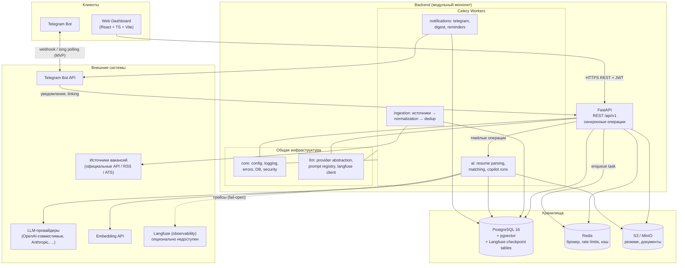
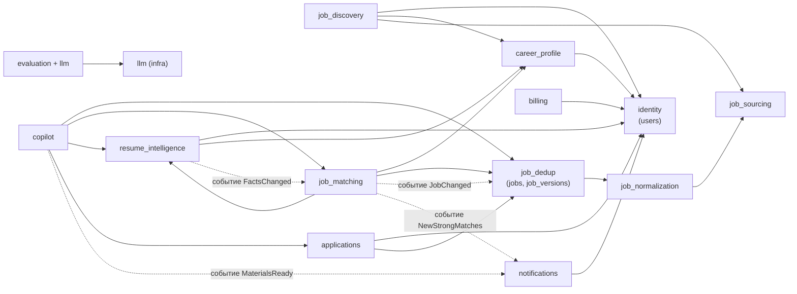

# CareerPilot AI — Architecture

- **Статус:** Draft v1.0 (Stage 0 — проектирование, реализации нет).
- **Связанные:** [PRD.md](PRD.md) · [DATABASE.md](DATABASE.md) · [API_SPEC.md](API_SPEC.md) · [AI_DESIGN.md](AI_DESIGN.md) · [INTEGRATIONS.md](INTEGRATIONS.md) · [SECURITY.md](SECURITY.md) · [DECISIONS.md](DECISIONS.md)

---

## 1. Архитектурный стиль: Modular Monolith

Единое деплой-подразделение (backend-приложение + Celery-воркеры), внутри — модули с явными границами и правилами зависимостей. Обоснование и альтернативы — [ADR-001](DECISIONS.md).

Свойства:

- один процесс FastAPI (API), пул Celery-воркеров (async jobs), одна БД PostgreSQL, один Redis, один S3;
- модули общаются только через **публичные сервисные интерфейсы** других модулей (Python API: функции/классы с DTO), либо через **доменные события** (transactional outbox);
- у каждого модуля — собственные таблицы; прямой доступ к чужим таблицам запрещён (правило проверяется код-ревью и, опционально, import-linter);
- выделение модуля в сервис в будущем = сведение его зависимостей к его публичному API (см. §6).

## 2. Технологический стек (итоговые решения)

Стек подтверждён с учётом проверок совместимости. Детальная аргументация — в [DECISIONS.md](DECISIONS.md).

| Слой | Технология | Проверка совместимости / замечания |
|---|---|---|
| Язык | Python 3.12+ | Общий знаменатель всех зависимостей |
| Web | FastAPI + Pydantic v2 | Pydantic v2 используется и LangGraph-состоянием, и API-схемами — единый слой валидации |
| ORM/миграции | SQLAlchemy 2.x (async, asyncpg) + Alembic | В API — async-сессии; в Celery-воркерах — sync-сессии (psycopg). Alembic — единственный источник схемы |
| БД | PostgreSQL 16 + расширения `pgvector`, `pgcrypto` | pgvector даёт векторный поиск без отдельной БД при объёме единицы тысяч вакансий (ADR-003) |
| Очереди/сейфы | Celery + Redis | Redis также: rate limiting источников, кэш, distributed locks. Альтернатива (arq/dramatiq) не даёт преимуществ для нашего графа задач (ADR-007) |
| AI orchestration | LangGraph + `langgraph-checkpoint-postgres` | Проверено: interrupt()/Command(resume=...), PostgresSaver — официальные возможности; персистентность и HITL из коробки (ADR-005) |
| LLM | Provider abstraction (прямые SDK: OpenAI-совместимые, Anthropic и др.), без LangChain-цепочек | LangGraph используется только как граф; ноды — обычный Python (ADR-006) |
| Observability LLM | Langfuse v3 (self-hosted или Cloud) | Проверено: self-hosting v3 = 6 контейнеров (web, worker, PG, Redis, ClickHouse, S3/MinIO) — учесть в инфраструктуре; ядро под MIT. Некритичная зависимость: fail-open (ADR-11) |
| Файлы | S3-compatible (MinIO в dev) | Резюме/документы приватно; presigned URLs |
| Frontend | React + TypeScript + Vite + TanStack Query + Zustand + Tailwind/shadcn | Согласовано; сервер — REST + OpenAPI codegen типов |
| Инфраструктура | Docker Compose (dev/single-node), GitHub Actions CI | K8s отложен до SaaS-фазы |
| Лексический поиск | PostgreSQL FTS (`tsvector` + `ts_rank_cd` + RRF fusion) | Точное замечание: ts_rank — не BM25. BM25 доступен через расширение `pg_search` (ParadeDB) как опция Stage 7, если evaluation покажет необходимость (ADR-004) |
| Эмбеддинги | Мультиязычная модель через provider abstraction; размерность фиксируется в БД (напр. 1536/1024) | Версионирование через `embedding_model` в таблице |

**Осознанно не включено:** LangSmith (дублирует Langfuse), LangChain (не нужен ради LangGraph), отдельная векторная БД, Kubernetes, брокеры сообщений (Kafka/RabbitMQ) — обоснования в DECISIONS.md.

## 3. Общая диаграмма (контейнеры)



Замечания к диаграмме:

- LangGraph checkpointer пишет в ту же PostgreSQL (отдельная схема `langgraph`), поэтому переживающий рестарты workflow не требует дополнительного хранилища.
- Telegram MVP: long polling через отдельный процесс/воркер; webhook — при публичном деплое.

## 4. Модули (домены → пакеты)

Каталог `backend/app/`:

```
backend/app/
├── core/                    # конфиг, логирование, БД, ошибки, middleware, security
├── llm/                     # (домен 12, часть 1) provider abstraction, prompt registry,
│                            # langfuse-обёртки (fail-open), маскирование PII, cost tracking
├── modules/
│   ├── identity/            # 1. Authentication & Users
│   ├── career_profile/      # 2. Career Profile
│   ├── resume_intelligence/ # 3. Resume Intelligence
│   ├── job_sourcing/        # 4. Job Sources (+ Source Adapter contract)
│   ├── job_discovery/       # 5. Job Discovery (поиски, оркестрация ingestion, верификация)
│   ├── job_normalization/   # 6. Job Normalization
│   ├── job_dedup/           # 7. Job Deduplication (+ канонические jobs/job_versions)
│   ├── job_matching/        # 8. Job Matching
│   ├── copilot/             # 9. Application Copilot (LangGraph)
│   ├── applications/        # 10. Application Management
│   ├── notifications/       # 11. Notifications
│   ├── evaluation/          # 12. AI Observability & Evaluation, часть 2: датасеты/прогоны/ai_invocations
│   └── billing/             # 13. Subscription & Usage (скелет, реализация позже)
├── workers/                 # Celery app + регистрация тасков модулей
└── main.py                  # сборка FastAPI-приложения
```

### 4.1 Матрица модулей

| # | Домен | Пакет | Ответственность | Владеет таблицами | Публичный API (примеры) |
|---|---|---|---|---|---|
| 1 | Authentication & Users | `identity` | Регистрация/вход, JWT + refresh-ротация, пользователи, локали | `users`, `refresh_tokens` | `authenticate`, `get_user`, `resolve_user_from_token` |
| 2 | Career Profile | `career_profile` | Целевые роли, предпочтения, hard filters, версии профиля | `career_profiles` | `get_active_profile(user_id)`, `validate_hard_filters(...)` |
| 3 | Resume Intelligence | `resume_intelligence` | Загрузка файлов, извлечение фактов, evidence, подтверждение, слияние | `resumes`, `profile_facts` | `start_parse(resume_id)`, `get_confirmed_facts(profile_id)`, `upsert_user_fact(...)` |
| 4 | Job Sources | `job_sourcing` | Реестр источников, Source Adapter contract, fetch, rate limits, raw payload | `job_sources`, `source_sync_runs` | `fetch_batch(source_code, query)`, `register_source(...)` |
| 5 | Job Discovery | `job_discovery` | Job Searches, планирование, оркестрация пайплайна ingestion, верификация свежести | `job_searches`, `search_runs` | `run_search(search_id)`, `recheck_job(job_id)`, `subscribe_search(...)` |
| 6 | Job Normalization | `job_normalization` | RawJobPosting → единая схема, очистка текста, извлечение структур, сохранение posting-записей | `job_postings` | `normalize_and_store(raw)`, `get_posting(posting_id)` |
| 7 | Job Deduplication | `job_dedup` | Fingerprint, кластеризация дублей, канонические вакансии, версионирование изменений | `jobs`, `job_versions` | `upsert_canonical(posting)`, `get_job(job_id)`, `list_versions(job_id)` |
| 8 | Job Matching | `job_matching` | Hard filters, гибридный retrieval, rerank, объяснимый скор, skill gaps, эмбеддинги вакансий | `job_matches`, `job_embeddings` | `match_job(job_id, profile)`, `match_pending(profile_id)`, `explain(match_id)` |
| 9 | Application Copilot | `copilot` | LangGraph workflow подготовки материалов, interrupt/resume, версии документов, fact check | `copilot_runs` | `start(application_id)`, `resume(run_id, input)`, `status(run_id)` |
| 10 | Application Management | `applications` | Воронка откликов, статусы, документы и их версии, экспорт | `applications`, `application_documents` | `create_application(...)`, `transition(id, status)`, `save_document_version(...)` |
| 11 | Notifications | `notifications` | Каналы (Telegram), очереди уведомлений, дайджесты, напоминания | `notifications`, `notification_channels` | `notify(user_id, type, payload)`, `link_telegram(code)` |
| 12 | AI Observability & Evaluation | `llm` + `evaluation` | Провайдеры LLM, промпты, трассировка (fail-open), cost; датасеты и прогоны оценок | `ai_invocations`, `evaluation_*` | `complete(...)`, `embed(...)`, `run_suite(suite)` |
| 13 | Subscription & Usage | `billing` | Планы, квоты, учёт использования (архитектурно) | `subscriptions`, `usage_records` | `check_quota(user_id, metric)` (всегда pass в MVP) |

Общая таблица `outbox_events` принадлежит `core` (инфраструктура событий).

### 4.2 Границы и правила зависимостей

Разрешено:

1. Любой модуль → `core`, `llm`.
2. Модуль → **публичный сервисный API** другого модуля (импорт только `modules.X.api` / `modules.X.dto`; не `models`, не `repositories`).
3. События — единственный способ «обратных» уведомлений о фактах, которые модуль не должен знать (см. §7).

Запрещено:

- обход публичного API (импорт internals чужого модуля);
- циклические зависимости между модулями;
- SQL к чужим таблицам (в т.ч. raw SQL, joins через границу — данные получаются через API другого модуля);
- вызов LLM-провайдеров напрямую, минуя `llm` (нужны трассировка, cost, маскирование, fallback).

### 4.3 Граф допустимых зависимостей модулей



Пунктир — событийные связи (обратные по потоку), реализуемые через outbox (§7): издатель не знает подписчиков.

Поток данных ingestion: `job_discovery` (оркестратор) вызывает `job_sourcing.fetch` → `job_normalization.normalize_and_store` → `job_dedup.upsert_canonical`; после коммита `job_dedup` публикует `JobChanged`, по которому `job_matching` (подписчик) пересчитывает матч и эмбеддинг.

## 5. Синхронные и асинхронные операции

Правило: **синхронно** — то, что укладывается в HTTP-бюджет (~секунды, без LLM); **асинхронно (Celery)** — сетевые вызовы источников, LLM-пайплайны, генерация документов, массовые пересчёты, отправка уведомлений.

| Операция | Режим | Исполнитель | SLA (гипотеза) |
|---|---|---|---|
| Auth, CRUD профилей/фактов, листинги | sync | FastAPI | p95 ≤ 300 мс |
| Поиск/фильтрация вакансий и матчей | sync (только чтение индексов) | FastAPI + PG | p95 ≤ 800 мс |
| `ingest.run_search` (опрос источников) | async | Celery `pipeline` queue | минуты |
| `sourcing.verify_postings` (свежесть) | async | Celery `pipeline` | часы, по расписанию |
| `resume.parse` (extract → facts) | async | Celery `ai` | ≤ 3 мин |
| `matching.match_job` / `match_pending` | async | Celery `ai` | ≤ 2 мин на батч |
| `embedding.embed_jobs` | async | Celery `ai` | минуты |
| `copilot.run` (LangGraph) | async | Celery `ai` | ≤ 5 мин активной фазы |
| `notifications.dispatch` | async | Celery `notify` | секунды-минуты |
| `evaluation.run_suite` | async | Celery `ai` (приоритет ниже) | минуты-часы |

Очереди Celery: `pipeline` (ingestion), `ai` (LLM-задачи), `notify`, `default`. Ретраи и идемпотентность — §8.

Паттерн запрос→задача→результат: API возвращает `202 + job/run id`; клиент поллит статус (`GET /resumes/{id}`, `GET /applications/{id}/copilot/status`). WebSocket/SSE — опция Stage 8 (не MVP).

## 6. Контракты взаимодействия

### 6.1 In-process (синхронные вызовы)

- Каждый модуль экспортирует `api.py` (сервисные функции) и `dto.py` (Pydantic-модели, вход/выход).
- DTO — единственный формат данных через границу. ORM-модели не покидают модуль.
- Синхронные вызовы только в направлении разрешённого графа (§4.3); вызов внутри одной транзакции БД допустим, если обе стороны согласны (например, `job_discovery` транзакционно пишет свои таблицы, а нормализацию выполняет через отдельную транзакцию на posting — чтобы сбой одного raw-элемента не откатывал батч).

### 6.2 Доменные события (transactional outbox)

Издатель в **той же транозакции** пишет событие в `outbox_events`; отдельный диспетчер (Celery-beat + воркер, `events.dispatch`) читает, доставляет подписчикам (в большинстве случаев — постановкой Celery-задачи) и помечает доставленным. Гарантии: at-least-once → обработчики идемпотентны.

Каталог событий (MVP):

| Событие | Издатель | Подписчики |
|---|---|---|
| `resume.parsed` | resume_intelligence | notifications (готовность к ревью фактов) |
| `facts.changed` | resume_intelligence / career_profile | job_matching (пересчёт матчей профиля) |
| `job.upserted` / `job.changed` | job_dedup | job_matching (эмбеддинг + матч), notifications (сильные матчи) |
| `copilot.awaiting_input` | copilot | notifications (вопрос пользователю) |
| `copilot.completed` | copilot | notifications (материалы готовы) |
| `application.status_changed` | applications | notifications (follow-up напоминания) |
| `sourcing.source_degraded` | job_sourcing | notifications (алерт владельцу) |

### 6.3 Контракты с инфраструктурой

- БД: только Alembic-миграции; каждая миграция обратима или сопровождается планом отката.
- S3: ключи с префиксом `users/{user_id}/...`; доступ — presigned URL с малым TTL.
- Redis: ключи с префиксом модуля (`cp:sourcing:{source}:rl`, `cp:match:lock:{profile}`), TTL обязателен.
- LLM: только через `llm.complete / llm.embed` (трейсинг, cost, маскирование, retry/fallback).

## 7. Обработка ошибок

### 7.1 Иерархия исключений (core.errors)

```
AppError (base; code, http_status, user_message, details)
├── ValidationError        # 422, детерминированные проверки
├── AuthError              # 401/403
├── NotFoundError          # 404 (+ tenant check)
├── ConflictError          # 409 (уникальности, переходы статусов)
├── RateLimitError         # 429
├── DomainRuleError        # 422/409, бизнес-правила
├── ExternalServiceError   # 502, внизу типы для sources/llm/storage/telegram
│   ├── TransientExternalError    # ретраится с backoff
│   ├── PermanentExternalError    # не ретраится; алерт
│   └── SourceAuthError           # авторизация источника истекла
└── InternalError          # 500, только лог; пользователю — обезличенное сообщение
```

Правила:

- API отвечает единым форматом ошибки: `{ "error": { "code", "message", "details", "request_id" } }` (примеры — [API_SPEC.md](API_SPEC.md)).
- Модуль не бросает чужие исключения наверх без оборачивания в собственный контракт.
- Celery-таски: retry с экспоненциальным backoff + jitter для `TransientExternalError` (по умолчанию 5 попыток), не ретраят `PermanentExternalError`/ошибки валидации. Каждая таска идемпотентна (см. §5 — параметры содержат естественные ключи: `resume_id`, `job_id`, `search_run_id`).
- Ингестия: обработка per-posting в изоляции (sub-transaction / savepoint): один битый raw-элемент → `source_sync_run.errors[]`, батч продолжается.
- Fallback LLM-провайдера: порядок провайдеров на задачу (например, extraction: primary → cheaper fallback); при исчерпании — `TransientExternalError` и ретрай задачи.

### 7.2 Классификация сбоев источников

`job_sourcing` ведёт health-статус источника (`healthy | degraded | down`) по окну последних запусков: подряд идущие `PermanentExternalError`/таймауты → degraded + алерт; авто-восстановление при успехе.

## 8. Логирование

- Библиотека: `structlog`; JSON-вывод в prod (logfmt/pretty — в dev).
- Обязательные поля: `timestamp`, `level`, `event`, `module`, `request_id` (middleware: `X-Request-Id`), `user_id` (если есть), `celery_task_id` (в воркерах).
- Уровни: DEBUG — детали dev; INFO — жизненный цикл операций (search run start/finish, copilot node transitions); WARNING — ретраи, деградация источника; ERROR — невыполненные операции с контекстом.
- **PII в логи не пишется**: тексты резюме, документов, промптов/ответов LLM — нельзя. Пишутся только идентификаторы и счётчики (токены, латентность). Полные тексты трассируются в Langfuse (с маскированием — [AI_DESIGN.md](AI_DESIGN.md) §9).
- LLM-вызовы логируются метаданными: `provider`, `model`, `purpose`, `tokens_in/out`, `latency_ms`, `cost_usd`, `trace_id`, `success`.
- Rate of ERROR на операцию — кандидат в алерты (Stage 8).

## 9. Конфигурация

- `pydantic-settings`, класс `Settings` с вложенными суб-настройками на модуль; переменные окружения с префиксом `CP_` (пример: `CP_DATABASE_URL`, `CP_LLM_PRIMARY_PROVIDER`).
- 12-factor: всё окружение, никаких конфиг-файлов в образе. Для локальной разработки — `.env` (в `.gitignore`).
- Профили: `local` (dev-упрощения), `production`. Неизвестные/невалидные переменные → отказ старта (fail-fast).
- Feature flags (минимальный набор): `CP_FEATURE_TELEGRAM`, `CP_FEATURE_DEDUP_SIMILARITY`, `CP_FEATURE_RERANKER`. Хранение — env; UI-флаги — отдельная таблица не нужна в MVP.
- Конфигурация источников (код источника, base_url, лимиты) — в БД (`job_sources.config`) с значениями по умолчанию из кода.

## 10. Секреты

- Локально: `.env` (не коммитится; пример — `.env.example`).
- Docker Compose: secrets через environment/.env файла compose; production: environment провайдера облака; опции на будущее — SOPS/Infisical (ADR-013).
- Никаких секретов в коде/образах/логах; токены источников и Telegram хранятся в БД **зашифрованными** (pgcrypto/envelope-шифрование, ключ из env — см. [SECURITY.md](SECURITY.md) §5).
- Ротация: refresh-токены короткоживущие, пароли — Argon2id; ротация ключа шифрования — runbook в Stage 8.

## 11. Топология деплоя (dev / single-node personal)

Docker Compose-сервисы (Stage 1):

| Сервис | Образ/назначение |
|---|---|
| `api` | backend: FastAPI + uvicorn |
| `worker-pipeline` | Celery worker (queues: pipeline, default) |
| `worker-ai` | Celery worker (queue: ai) + beat-планировщик |
| `worker-notify` | Celery worker (queue: notify) + telegram poller |
| `db` | PostgreSQL 16 + pgvector |
| `redis` | Redis 7 |
| `minio` | S3 для файлов |
| `frontend` | статика (nginx) |
| `langfuse-*` (опционально) | 6 контейнеров Langfuse v3 **или** использование Langfuse Cloud |

CI (GitHub Actions): lint (ruff, mypy) → tests (pytest, testcontainers PG/Redis) → OpenAPI/contract checks → docker build. Детали — [EVALUATION.md](EVALUATION.md) §7.

## 12. Структура репозитория (проект)

```
ai-career-pilot/
├── docs/                    # эта документация
├── backend/
│   ├── app/                 # см. §4
│   ├── alembic/             # миграции
│   ├── tests/               # unit / integration / contract / e2e / eval
│   └── pyproject.toml
├── frontend/
│   ├── src/
│   └── package.json
├── docker/                  # compose-файлы, Dockerfile'ы
└── .github/workflows/
```

Создание каталогов — по мере Stage (правило Stage 0: не создавать пустых структур).

## 13. Аргументация ключевых решений (сводка)

| Решение | Почему | Альтернатива отклонена | ADR |
|---|---|---|---|
| Modular monolith | single-user MVP, один деплой, но границы для будущего SaaS | Микросervices: операционная сложность без выгод | [ADR-001](DECISIONS.md) |
| PostgreSQL+pgvector, FTS+RRF | объём данных мал; одна БД; гибридный поиск | Qdrant/Weaviata/Elastic: ещё 1–2 системы ради выигрыша на наших объёмах | ADR-003/004 |
| LangGraph | need: stateful, interrupt/resume, HITL, checkpointing — ровно требования Copilot | Оркестрация вручную/Temporal: дублирование/избыточность | ADR-005 |
| Langfuse, fail-open | трассировка, промпты, датасеты, self-host MIT; отсутствие не должно ломать продукт | LangSmith (лишняя зависимость), без observability (нельзя отлаживать генерацию) | ADR-11 |
| Celery+Redis | зрелость, beat-расписания, retry, приоритеты очередей | arq/dramatiq/RQ: меньше экосистемы; Temporal: overkill | ADR-007 |
| Provider abstraction | смена/деградация провайдеров, cost routing, единый учёт | Прямые SDK-вызовы из модулей: хаос трассировки и стоимости | ADR-006 |
| Prepare, not send | контроль пользователя, ToS площадок, качество | автоотправка: риски и этика | ADR-008 |

## 14. Что в этой архитектуре отсутствует намеренно

- Микросервисы, service mesh, K8s, API-gateway.
- Брокер сообщений (Kafka/RabbitMQ) — события in-process через outbox+Redis достаточно для наших масштабов.
- GraphQL, tRPC — REST+OpenAPI закрывает потребности Dashboard.
- Отдельный search-движок (Elastic/Typesense) — до подтверждения недостаточности PG FTS измерениями.
- Многоязычная генерация UI на бэкенде — i18n на фронте; бэкенд хранит локаль и язык документов.
- Реализация всех этих вещей возможна позже без слома границ модулей (эволюционные пути описаны в DECISIONS.md).
