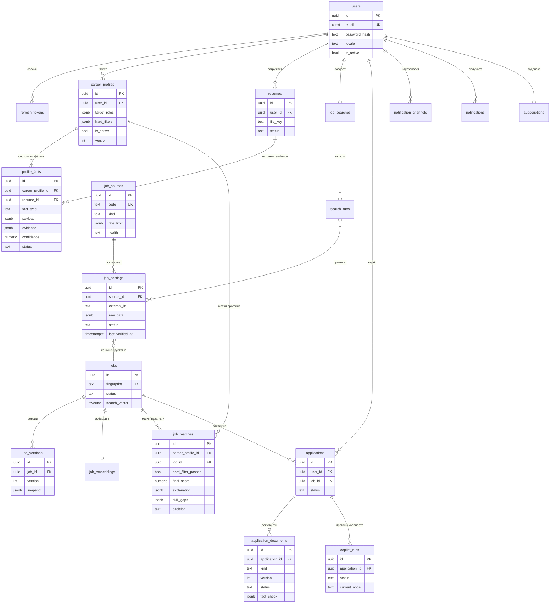

# CareerPilot AI — Database Design

- **Статус:** Draft v1.0 (Stage 0 — проектирование, реализации нет).
- **СУБД:** PostgreSQL 16, расширения: `pgvector`, `pgcrypto`, `citext` (email), `pg_trgm` (fuzzy-дедуп названий).
- **Связанные:** [ARCHITECTURE.md](ARCHITECTURE.md) · [API_SPEC.md](API_SPEC.md) · [SECURITY.md](SECURITY.md)

---

## 1. Конвенции

| Аспект | Решение |
|---|---|
| PK | `id UUID` (v7, генерируется приложением — временно упорядочены, удобны для пагинации и индексов) |
| Время | `timestamptz` (UTC); `created_at` / `updated_at` на всех таблицах, где важна история |
| Именование | snake_case; таблицы во множественном числе; индексы `idx_<table>_<cols>`, уникальные `uq_...` |
| Enum | PostgreSQL `ENUM`-типы для стабильных наборов; jsonb для эволюционирующих структур |
| Деньги | `salary` — jsonb `{min, max, currency, period, gross}`; расчётов в БД нет |
| Soft delete | Не используется; удаление пользователя — каскад (см. §6). История изменений — через версии/аудит-таблицы, а не через `deleted_at` |
| Схемы | `public` (доменные таблицы), `langgraph` (чекпоинты LangGraph — управляется библиотекой `langgraph-checkpoint-postgres`, не мигрируется нашим Alembic) |
| Миграции | Только Alembic; каждая миграция реверсибельна или с планом отката |

**Классификация таблиц по tenancy (критично для изоляции, см. §5):**

- **tenant-таблицы** (есть `user_id`): `career_profiles`, `resumes`, `profile_facts`, `job_searches`, `search_runs`(user-атрибут), `job_matches`, `applications`, `application_documents`, `copilot_runs`, `notifications`, `notification_channels`, `subscriptions`, `usage_records`, `ai_invocations`, `refresh_tokens`.
- **глобальные таблицы** (общий каталог вакансий): `job_sources`, `source_sync_runs`, `job_postings`, `jobs`, `job_versions`, `job_embeddings`.
- **сервисные**: `outbox_events`, `evaluation_*` (внутренние, без user-данных).

---

## 2. ER-диаграмма (основные сущности)



Вспомогательные таблицы (`source_sync_runs`, `outbox_events`, `ai_invocations`, `evaluation_*`, `subscriptions`, `usage_records`, `notification_channels`, `refresh_tokens`, `search_runs`, `job_embeddings`) на диаграмме опущены для читаемости — описаны ниже.

---

## 3. Таблицы по модулям

### 3.1 `identity`

#### users

Назначение: учётные записи. Основа multi-tenancy.

| Колонка | Тип | Null | Описание |
|---|---|---|---|
| id | uuid PK | no | UUIDv7 |
| email | citext | no | уникальный, lowercase |
| password_hash | text | no | Argon2id |
| display_name | text | yes | отображаемое имя |
| locale | text | no | `ru` \| `en` (default `ru`) |
| timezone | text | no | IANA tz (default `Europe/Moscow` — настройка при регистрации) |
| is_active | boolean | no | деактивация вместо удаления при спорных ситуациях |
| last_login_at | timestamptz | yes | |
| created_at / updated_at | timestamptz | no | |

Индексы/ограничения: `uq_users_email UNIQUE(email)`; `idx_users_locale`.
Удаление: `DELETE` → каскад на все tenant-таблицы (§6).

#### refresh_tokens

Назначение: ротация refresh-сессий (access-JWT stateless, 15 мин).

| Колонка | Тип | Описание |
|---|---|---|
| id | uuid PK | |
| user_id | uuid FK→users ON DELETE CASCADE | |
| token_hash | text | sha256(refresh_token); сам токен не хранится; UNIQUE |
| expires_at | timestamptz | TTL 30 дней |
| revoked_at | timestamptz | null = активен; ротация отзывает предыдущий |
| user_agent / ip | text / inet | аудит устройства |

Индексы: `idx_refresh_tokens_user`, `idx_refresh_tokens_expires` (очистка истёкших).
Правила: при реюзе отозванного токена — отозвать все токены пользователя (detector).

### 3.2 `career_profile`

#### career_profiles

Назначение: целевые параметры поиска пользователя; одна запись = один «профиль охоты» (например, «AI Engineer» или «Frontend + AI»).

| Колонка | Тип | Описание |
|---|---|---|
| id | uuid PK | |
| user_id | uuid FK→users CASCADE | |
| name | text | «AI/LLM Engineer», для UI |
| target_roles | jsonb | `[{"role": "AI Engineer", "seniority": "senior"}, ...]` — роли задаются свободно + seniority |
| salary_min / salary_max | numeric | желаемая вилка; null = не указана |
| currency | text | ISO-4217 (default `RUB`) |
| locations | jsonb | `[{"country": "RU", "city": "..."}, {"country": "any", "remote": true}]` |
| work_formats | jsonb | подсеть `["remote","hybrid","onsite"]` |
| employment_types | jsonb | `["full_time","part_time","contract","b2b"]` |
| relocation | jsonb | `{"willing": bool, "regions": [...]}` |
| languages | jsonb | `[{"lang": "en", "level": "b2+"}]` — требование к языку вакансии/компании |
| hard_filters | jsonb | массив фильтров, схема в §3.2.1 |
| settings | jsonb | прочее UI (порог скора в ленте и т.п.) |
| version | int | инкремент при изменении; фиксируется в job_matches для воспроизводимости |
| is_active | boolean | один активный профиль на пользователя |
| activated_at | timestamptz | |

Индексы: `uq_career_profiles_active UNIQUE(user_id) WHERE is_active`.
Изменения: история не хранится построчно; `version` + `updated_at` достаточно для воспроизводимости матчей (в `job_matches` пишется profile_version).

**3.2.1. Схема `hard_filters`** (jsonb, валидируется Pydantic):

```jsonc
[
  {"type": "work_format", "op": "require_any", "values": ["remote"], "severity": "disqualify"},
  {"type": "excluded_companies", "op": "exclude", "values": ["Акме ООО", "Acme Inc"], "severity": "disqualify"},
  {"type": "salary_min", "op": ">=", "value": 250000, "currency": "RUB", "severity": "warn"},
  {"type": "visa_sponsorship", "op": "required", "severity": "disqualify"},
  {"type": "job_language", "op": "in", "values": ["en", "ru"], "severity": "warn"},
  {"type": "max_commute", "op": "<=", "value": "hybrid_2_days", "severity": "warn"}
]
```

`severity: disqualify` — нарушение исключает вакансию из выдачи независимо от скора; `warn` — показывать с предупреждением и штрафом к скору. Список типов расширяем.

### 3.3 `resume_intelligence`

#### resumes

Назначение: загруженные файлы резюме. Запись иммутабельна (новая загрузка = новая запись); содержимое — в S3.

| Колонка | Тип | Описание |
|---|---|---|
| id | uuid PK | |
| user_id | uuid FK→users CASCADE | |
| file_key | text | S3: `users/{user_id}/resumes/{id}/{filename}` |
| filename / mime_type / size_bytes | text | `application/pdf` \| `application/vnd.openxmlformats-officedocument.wordprocessingml.document`; лимит 15 МБ |
| checksum_sha256 | text | дедуп повторной загрузки |
| language | text | определённый язык документа (`ru`/`en`/...) |
| status | enum resume_status | `uploaded → parsing → parsed` \| `failed` |
| parse_error | jsonb | `{code, message, retried}` |
| parsed_at | timestamptz | |

Индексы: `uq_resumes_user_checksum UNIQUE(user_id, checksum_sha256)` (повторная загрузка того же файла возвращает существующую запись).

#### profile_facts

Назначение: атомарные, подтверждаемые факты карьеры. Единственный источник правды для матчинга и генерации.

| Колонка | Тип | Описание |
|---|---|---|
| id | uuid PK | |
| user_id | uuid FK→users CASCADE | денормализация для изоляции и RLS |
| career_profile_id | uuid FK→career_profiles CASCADE | факты принадлежат профилю охоты |
| resume_id | uuid FK→resumes CASCADE, null | null для фактов, добавленных вручную |
| fact_type | enum fact_type | `skill` \| `position` \| `experience` \| `project` \| `education` \| `certification` \| `language` \| `achievement` |
| payload | jsonb | нормализованное значение; схемы по типам в §3.3.1 |
| evidence | jsonb | `[{resume_id, quote, section, page?}]`; **обязателен** при source=`llm_extraction` |
| confidence | numeric(4,3) | 0..1 от экстрактора |
| source | enum fact_source | `llm_extraction` \| `user_input` \| `merge` |
| status | enum fact_status | `draft` (из LLM, ждёт подтверждения) \| `confirmed` \| `rejected` \| `superseded` |
| verified | boolean | true после подтверждения пользователем |
| verified_at | timestamptz | |
| valid_from / valid_to | date | для `experience`/`education` (длительности) |
| superseded_by | uuid FK→profile_facts | цепочка при редактировании |

Индексы: `idx_facts_profile_type (career_profile_id, fact_type, status)`; `idx_facts_resume (resume_id)`; GIN `idx_facts_payload` (запросы по навыкам).
Ограничение (уровень приложения + CHECK при source='llm_extraction'): `jsonb_array_length(evidence) > 0`.
Удаление: resume CASCADE удаляет факты этого резюме; **исключение**: факты со status=confirmed переживают удаление резюме (обновляется evidence→«источник удалён») — решение: confirmed-факты принадлежат пользователю, а не файлу. Реализуется в сервисном слое (`ON DELETE` не справится — документируем как поведение приложения).

**3.3.1. Примеры `payload`:**

```jsonc
// skill
{"skill": "PyTorch", "skill_id": "pytorch", "category": "ml", "level": "advanced",
 "context": "production training pipelines"}

// experience
{"company": "ООО Ромашка", "company_norm": "romashka", "title": "Senior Frontend Developer",
 "start": "2022-03", "end": null, "employment": "full_time"}

// project
{"name": "RAG support assistant", "role": "lead engineer",
 "highlights": ["reduced deflection 35%", "pgvector hybrid retrieval"],
 "stack": ["fastapi", "langgraph", "pgvector"]}
```

### 3.4 `job_sourcing`

#### job_sources

Назначение: реестр источников. Global.

| Колонка | Тип | Описание |
|---|---|---|
| id | uuid PK | |
| code | text UNIQUE | `hh_ru`, `arbeitnow`, `remotive`, `adzuna`, `hn_algolia`, `greenhouse_board`, `lever_board`, `career_rss` |
| name | text | человекочитаемое |
| kind | enum source_kind | `api` \| `rss` \| `ats_board` \| `career_page` |
| base_url | text | |
| config | jsonb | специфика адаптера (API version, board id, категории) |
| rate_limit | jsonb | `{requests_per_minute, burst, daily_cap, respect_retry_after: true}` |
| credentials_enc | bytea | зашифрованные токены (pgcrypto, ключ в env); null для открытых API |
| is_active | boolean | выключение источника без удаления |
| health | enum source_health | `healthy` \| `degraded` \| `down` (обновляется по окну запусков) |
| last_sync_at / last_error_at | timestamptz | |

#### source_sync_runs

Назначение: журнал обращений к источнику (диагностика, health, аудит лимитов).

| Колонка | Тип | Описание |
|---|---|---|
| id | uuid PK | |
| source_id | uuid FK→job_sources CASCADE | |
| search_run_id | uuid FK→search_runs, null | null для служебных прогонов (verify) |
| status | enum sync_status | `running` \| `success` \| `partial` \| `failed` |
| stats | jsonb | `{fetched, new, updated, duplicates, skipped}` |
| errors | jsonb | массив `{external_id?, code, message}` |
| started_at / finished_at | timestamptz | |

Индексы: `idx_sync_runs_source_time (source_id, started_at DESC)`; `idx_sync_runs_status_time`.
Хранение: партиционирование по месяцам при росте (Stage 8), пока — purge старше 6 месяцев.

### 3.5 `job_discovery`

#### job_searches

Назначение: поисковые подписки пользователя.

| Колонка | Тип | Описание |
|---|---|---|
| id | uuid PK | |
| user_id | uuid FK→users CASCADE | |
| career_profile_id | uuid FK→career_profiles CASCADE | параметры матча берутся из профиля |
| name | text | UI |
| query | jsonb | `{keywords: ["AI Engineer","LLM Engineer"], sources: ["arbeitnow","remotive"], locations: [...], remote_only: bool}` |
| schedule | jsonb | `{interval_minutes: 120, jitter: true}`; cron-подобное расширение позже |
| is_active | boolean | пауза |
| last_run_at / next_run_at | timestamptz | планировщик (Celery beat → таска выбирает due-поиски `FOR UPDATE SKIP LOCKED`) |

#### search_runs

Назначение: конкретный прогон поиска (аудит «что нашли и когда»).

| Колонка | Тип | Описание |
|---|---|---|
| id | uuid PK | |
| search_id | uuid FK→job_searches CASCADE | |
| user_id | uuid FK→users CASCADE | |
| trigger | enum run_trigger | `scheduled` \| `manual` |
| status | enum run_status | `running` \| `success` \| `partial` \| `failed` |
| stats | jsonb | `{sources: {code: {new, updated}}, postings_seen, jobs_created, matches_computed}` |
| started_at / finished_at | timestamptz | |

Индексы: `idx_search_runs (search_id, started_at DESC)`.

### 3.6 `job_normalization`

#### job_postings

Назначение: экземпляр объявления на конкретном источнике (raw + нормализованные поля). Именно здесь живут поля контракта Source Adapter (см. [INTEGRATIONS.md](INTEGRATIONS.md) §3).

| Колонка | Тип | Описание |
|---|---|---|
| id | uuid PK | |
| source_id | uuid FK→job_sources | |
| external_id | text | id в системе источника |
| source_url | text | канонический URL для пользователя |
| raw_data | jsonb | ответ источника как есть (provenance; недоверенный контент) |
| title / company_name | text | нормализованные (unicode NFKC, whitespace) |
| company_norm | text | нормализованное имя компании (lowercase, legal forms removed) — для дедупа |
| location_text | text | сырая локация («Москва, гибрид») |
| country_code | text | ISO-3166, выведен нормализатором (nullable) |
| remote_type | enum remote_type | `remote` \| `hybrid` \| `onsite` \| `unknown` |
| employment_type | text | normalized `full_time`/... |
| salary | jsonb | `{min, max, currency, period, gross}` |
| description_text | text | plain text (html stripped, sane truncation cap 200 KB) |
| description_structured | jsonb | `{responsibilities: [], requirements_must: [], requirements_nice: [], questions: []}` |
| language | text | `ru`/`en`/... |
| skills_detected | jsonb | `[{skill_id, section, mention}]` |
| normalized_checksum | text | sha256 нормализованного payload — «изменилось ли что-то» |
| published_at | timestamptz | с источника (nullable) |
| first_seen_at / last_seen_at | timestamptz | наши наблюдения |
| last_verified_at | timestamptz | последний успешный recheck |
| status | enum posting_status | `active` \| `closed` \| `gone` \| `unverified` |
| canonical_job_id | uuid FK→jobs SET NULL, null | проставляет дедуп |
| search_runs_ids | uuid[] | какие прогоны принесли (обрезаем до последних) |

Индексы/ограничения:
- `uq_job_postings_source_external UNIQUE(source_id, external_id)` — идемпотентность ingestion;
- `idx_job_postings_canonical (canonical_job_id)`;
- `idx_job_postings_status_seen (status, last_seen_at DESC)` — очередь верификации;
- `idx_job_postings_normalized_checksum` — быстрый diff;
- GIN pg_trgm `(company_norm)` — fuzzy-поиск кандидатов на дедуп.

### 3.7 `job_dedup`

#### jobs

Назначение: каноническая вакансия — результат слияния postings. Global. Именно её видит пользователь.

| Колонка | Тип | Описание |
|---|---|---|
| id | uuid PK | |
| fingerprint | text UNIQUE | детерминированный hash `sha256(title_norm + company_norm + location_norm)`; exact-дедуп |
| title / company_name / company_norm | text | лучшие значения из postings (правила merge: приоритет источника + полнота) |
| location / remote_type / employment_type / salary | — | смерженные поля |
| description_text | text | canonical: описание самой свежей активной posting |
| language | text | язык канонического описания |
| best_source_url | text | ссылка, показываемая пользователю |
| published_at | timestamptz | earliest по postings |
| first_seen_at / last_seen_at | timestamptz | |
| last_verified_at | timestamptz | max по активным postings |
| status | enum job_status | `active` \| `closed` \| `stale` \| `archived` |
| current_version_id | uuid FK→job_versions, null | циклическая FK — см. примечание |
| search_vector | tsvector GENERATED ALWAYS AS (...) STORED | `to_tsvector('simple', title || ' ' || description_text)` — конфиг `simple`, т.к. текст преднормализован и мультиязычен |

Индексы: `idx_jobs_status_published (status, published_at DESC)`; GIN `idx_jobs_search_vector`; `uq_jobs_fingerprint`.
Циклическая FK `jobs.current_version_id ↔ job_versions.job_id` решается двухшаговой вставкой (insert job → insert version → update current_version_id) — обе FK nullable, без DEFERRABLE.

`stale` — не верифицировалась дольше N дней (гипотеза: 7) при неактивном recheck; политика статусов описана в [INTEGRATIONS.md](INTEGRATIONS.md) §6.

#### job_versions

Назначение: история изменений канонической вакансии (требование «отслеживать изменения описания и актуальности»).

| Колонка | Тип | Описание |
|---|---|---|
| id | uuid PK | |
| job_id | uuid FK→jobs CASCADE | |
| version | int | 1..N; 1 = initial |
| snapshot | jsonb | полный снимок нормализованных полей на версию |
| changed_fields | text[] | что изменилось относительно предыдущей версии |
| reason | enum version_reason | `initial` \| `source_update` \| `recheck` \| `merge` \| `status_change` |
| triggered_posting_id | uuid FK→job_postings, null | какой posting вызвал |
| created_at | timestamptz | |

Ограничение: `uq_job_versions (job_id, version)`.
Хранение: полные snapshot (проще аудита и диффа); удержание — последние 20 версий на вакансию + все версии активных вакансий (purge-задача, Stage 8). Для закрытых вакансий старше 6 месяцев — сжатие до последней версии.

### 3.8 `job_matching`

#### job_embeddings

Назначение: эмбеддинги канонических вакансий. Отдельная таблица (не колонка в jobs) — чтобы менять модель без каскадов и не раздувать hot-таблицу.

| Колонка | Тип | Описание |
|---|---|---|
| job_id | uuid PK, FK→jobs CASCADE | |
| embedding | vector(1536) | размерность = выбранной модели; смена модели → миграция |
| model | text | `text-embedding-3-small@2026-01` — версионирование обязательно |
| content_hash | text | хеш текста, для которого считали — детект рассинхрона |
| updated_at | timestamptz | |

Индексы: `HNSW (embedding vector_cosine_ops)` с параметрами `m=16, ef_construction=64` (стартовые; тюнинг по измерениям).

#### job_matches

Назначение: результат матчинга вакансии с профилем + решение пользователя. Tenant.

| Колонка | Тип | Описание |
|---|---|---|
| id | uuid PK | |
| user_id | uuid FK→users CASCADE | денормализация для RLS |
| career_profile_id | uuid FK→career_profiles CASCADE | |
| profile_version | int | версия профиля на момент расчёта |
| job_id | uuid FK→jobs CASCADE | |
| job_version | int | версия вакансии на момент расчёта |
| hard_filter_passed | boolean | `false` → вакансия исключена из дефолтной выдачи |
| hard_filter_violations | jsonb | `[{filter_type, severity, expected, actual}]` |
| lexical_score / semantic_score / rerank_score | numeric | компоненты (rerank null, если не применялся) |
| final_score | numeric(5,4) | 0..1; при нарушенном disqualify-фильтре принудительно ≤ порога исключения и не показывается в выдаче (см. [AI_DESIGN.md](AI_DESIGN.md) §5) |
| explanation | jsonb | см. §3.8.1 |
| skill_gaps | jsonb | `[{requirement, critical: bool, related_skills: []}]` |
| matched_requirements | jsonb | `[{requirement, fact_ids: [], strength}]` |
| engine_version | text | версия алгоритма матчинга |
| model_info | jsonb | какие модели/промпты участвовали |
| decision | enum match_decision | `none` \| `interested` \| `dismissed` \| `not_interested` \| `will_apply` |
| decision_at | timestamptz | |
| computed_at | timestamptz | пересчёт = UPDATE in place + запись в `history` |

Индексы/ограничения: `uq_job_matches (career_profile_id, job_id)`; `idx_job_matches_feed (user_id, hard_filter_passed, final_score DESC)`; `idx_job_matches_decision`.
`history` (jsonb): краткие записи предыдущих пересчётов `{at, engine_version, final_score}` — полная история не нужна.

**3.8.1. Пример `explanation`:**

```jsonc
{
  "summary": "Сильный матч: 8/10 обязательных требований закрыты опытом",
  "components": {
    "hard_filters": {"passed": true},
    "skills": {"score": 0.82, "matched": ["Python", "LLM APIs", "RAG"], "missing_critical": ["Kubernetes"], "missing_nice": ["Rust"]},
    "experience": {"score": 0.9, "required_years": 3, "profile_years": 5},
    "semantics": {"score": 0.76, "note": "профиль LLM-инженерии близко к требованиям RAG-платформы"},
    "logistics": {"score": 1.0, "note": "remote подходит"}
  },
  "evidence": [
    {"requirement": "Опыт production RAG", "verdict": "covered",
     "fact_ids": ["<profile_fact.uuid>", "..."],
     "evidence_quote": "...reduced deflection 35% with hybrid retrieval..."},
    {"requirement": "Kubernetes в проде", "verdict": "gap", "critical": true}
  ]
}
```

### 3.9 `copilot`

#### copilot_runs

Назначение: связь Application ↔ LangGraph-выполнение. Сам граф-стейт и чекпоинты хранятся в схеме `langgraph` (PostgresSaver) — здесь только бизнес-метаданные.

| Колонка | Тип | Описание |
|---|---|---|
| id | uuid PK | = thread_id LangGraph |
| application_id | uuid FK→applications CASCADE | |
| user_id | uuid FK→users CASCADE | |
| status | enum copilot_status | `running` \| `waiting_user` \| `completed` \| `failed` \| `cancelled` |
| current_node | text | последняя нода |
| await_payload | jsonb | снапшот interrupt: вопросы/документы для ревью (удобно для UI без чтения чекпоинтов) |
| error | jsonb | `{code, message, node}` |
| attempts | int | число запусков/перезапусков |
| started_at / finished_at / updated_at | timestamptz | |

Индексы: `idx_copilot_runs_application`, `idx_copilot_runs_status`.
Политика: одна активная run на application (partial unique `WHERE status IN ('running','waiting_user')`).

### 3.10 `applications`

#### applications

Назначение: карточка отклика (воронка). Tenant.

| Колонка | Тип | Описание |
|---|---|---|
| id | uuid PK | |
| user_id | uuid FK→users CASCADE | |
| job_id | uuid FK→jobs CASCADE | |
| career_profile_id | uuid FK | контекст, на который готовили отклик |
| status | enum application_status | `draft` \| `awaiting_input` \| `materials_ready` \| `submitted` \| `interview` \| `offer` \| `rejected` \| `withdrawn` \| `archived` |
| source | enum application_source | `copilot` \| `manual` |
| applied_at | timestamptz | момент ручной отправки (ставит пользователь) |
| notes | text | |
| next_action / next_action_at | text / timestamptz | follow-up напоминания |
| created_at / updated_at | timestamptz | |

Ограничения: `uq_applications_user_job UNIQUE(user_id, job_id)`; переходы статусов — конечный автомат в сервисном слое (схема в [API_SPEC.md](API_SPEC.md) §7).
История статусов: таблица-аудит `application_status_history (id, application_id, from, to, at, note)` (Stage 6).

#### application_documents

Назначение: версии генерируемых документов. Tenant.

| Колонка | Тип | Описание |
|---|---|---|
| id | uuid PK | |
| application_id | uuid FK→applications CASCADE | |
| kind | enum document_kind | `resume` \| `cover_letter` \| `answers` |
| version | int | 1..N на (application, kind) |
| origin | enum document_origin | `generated` \| `user_edit` \| `regeneration` |
| parent_version | int | с какой версии сделана правка/перегенерация |
| format | text | источник: `md` (canonical); экспорт в docx/pdf — файлы в S3 |
| content_text | text | markdown-тело (для diff, fact-check, истории) |
| file_key | text | S3 экспорт-файлы `users/{uid}/applications/{aid}/{kind}-v{n}.docx` |
| fact_check | jsonb | отчёт fact_checker: `[{claim, verdict: supported|unsupported|unverifiable, fact_ids}]` |
| review_status | enum doc_status | `draft` \| `needs_edit` \| `approved` \| `superseded` |
| created_by | text | `copilot:<run_id>` \| `user` |
| created_at | timestamptz | |

Ограничение: `uq_application_documents (application_id, kind, version)`; новая версия — INSERT (иммутабельность истории), «текущая» = max(version) с review_status != superseded.

### 3.11 `notifications`

#### notification_channels

| Колонка | Тип | Описание |
|---|---|---|
| id | uuid PK | |
| user_id | uuid FK→users CASCADE | |
| type | enum channel_type | `telegram` \| `email` (зарезервирован) |
| external_id | text | telegram chat id |
| config | jsonb | настройки: per-type подписки, quiet hours, порог скора для матчей |
| is_active / verified_at | bool / timestamptz | |

Ограничение: `uq_notification_channels (user_id, type)`; `uq_channels_external (type, external_id)` — один telegram-чат на аккаунт.

#### notifications

| Колонка | Тип | Описание |
|---|---|---|
| id | uuid PK | |
| user_id | uuid FK→users CASCADE | |
| channel_id | uuid FK→notification_channels CASCADE | |
| type | text | `new_strong_matches` \| `copilot_question` \| `materials_ready` \| `followup_reminder` \| `source_degraded` |
| payload | jsonb | данные для рендера сообщения |
| dedup_key | text | идемпотентность (например `match:{profile_id}:{job_id}`) |
| status | enum notif_status | `pending` \| `sent` \| `failed` \| `read` |
| scheduled_at / sent_at | timestamptz | отложенные (quiet hours, дайджесты) |
| error / external_message_id | text | |

Индексы: `idx_notifications_user_status (user_id, status)`, `uq_notifications_dedup (user_id, dedup_key)` (partial, WHERE dedup_key IS NOT NULL).

### 3.12 `evaluation` (домен AI Observability & Evaluation)

#### ai_invocations

Назначение: собственный учёт LLM-вызовов (стоимость/квоты не должны зависеть от Langfuse). Tenant по user_id (null для системных/eval вызовов).

| Колонка | Тип | Описание |
|---|---|---|
| id | uuid PK | |
| user_id | uuid FK→users CASCADE, null | |
| purpose | text | `resume_parse` \| `match_score` \| `copilot_node` \| `embedding` \| `fact_check` \| `evaluation` |
| provider / model / prompt_version | text | |
| tokens_in / tokens_out | int | |
| cost_usd | numeric(10,6) | расчёт по тарифу провайдера |
| latency_ms | int | |
| trace_id | text | связь с Langfuse trace (если доступен) |
| status | text | `ok` \| `error:<code>` |
| created_at | timestamptz | |

Индексы: `idx_ai_invocations_user_time (user_id, created_at DESC)`, `idx_ai_invocations_purpose_time`.

#### evaluation_datasets / evaluation_cases

| Таблица | Ключевые поля |
|---|---|
| evaluation_datasets | id, name UNIQUE, suite enum (`resume_extraction` \| `job_matching` \| `generation` \| `retrieval`), description, created_at |
| evaluation_cases | id, dataset_id FK CASCADE, input jsonb, expected jsonb, notes, weight numeric default 1.0, created_at, updated_at |

#### evaluation_runs / evaluation_case_results

| Таблица | Ключевые поля |
|---|---|
| evaluation_runs | id, dataset_id FK, config jsonb (модели, версии промптов, фичи), metrics jsonb (агрегаты), status, git_sha, started_at, finished_at |
| evaluation_case_results | id, run_id FK CASCADE, case_id FK, output jsonb, scores jsonb (per-metric), error jsonb |

Связь с Langfuse: в `config` пишется dataset name; детали — [EVALUATION.md](EVALUATION.md).

### 3.13 `billing` (архитектурно, реализация позже)

| Таблица | Ключевые поля |
|---|---|
| subscriptions | id, user_id FK CASCADE, plan (`free`\|`pro`), status, current_period_start/end, provider (null в MVP), external_id, cancel_at_period_end |
| usage_records | id, user_id FK CASCADE, period date (первое число месяца), metric enum (`llm_tokens`\|`generations`\|`search_runs`\|`api_calls`), value bigint, quota bigint; `uq_usage (user_id, period, metric)` |

В MVP `billing.check_quota()` всегда pass, но все операции уже пишут `usage_records` (наращивание счётчика) — подключение лимитов не потребует рефакторинга.

### 3.14 `core`

#### outbox_events

| Колонка | Тип | Описание |
|---|---|---|
| id | bigserial PK | |
| event_type | text | `job.changed`, `facts.changed`, ... |
| aggregate_type / aggregate_id | text / uuid | |
| payload | jsonb | |
| status | text | `new` \| `dispatched` \| `failed` |
| attempts / created_at / dispatched_at | int / timestamptz | |

Индексы: `idx_outbox_pending (status, created_at)` — диспетчер `FOR UPDATE SKIP LOCKED`.
Хранение: purge dispatched старше 7 дней.

---

## 4. Модель вакансий: поток данных

```
source (raw)  →  job_postings (нормализованный экземпляр, N на источник)
                     │  dedup: fingerprint → jobs
                     ▼
                 jobs (каноническая, 1) ←─ job_versions (история изменений)
                     │                        job_embeddings (для поиска)
                     ▼
                 job_matches (user × job)
```

Правила слияния (dedup), подробнее [INTEGRATIONS.md](INTEGRATIONS.md) §5:

1. **Exact**: совпадение `fingerprint` (title_norm + company_norm + location_norm) → новый posting прикрепляется к существующему job (updated last_seen, возможно новый job_version при изменениях).
2. **Similar** (Stage 6, feature flag): trigram company_norm + близость эмбеддингов порог — кандидат на слияние, ручная проверка владельцем.
3. Изменение `normalized_checksum` у posting → пересборка canonical полей → если diff не пуст, пишется `job_versions` (reason=source_update).
4. `jobs.status` агрегирует статусы postings: все closed/gone → `closed`; иначе `active`.

## 5. Multi-tenancy

1. **Прикладной уровень (основной):** каждый репозиторий tenant-таблиц обязан фильтровать по `user_id`; доступ к сущности = `get_by_id(user_id, id)` — API-слой передаёт user из JWT. Нарушение ловится контрактными тестами (запрос чужого id → 404, не 403 — не раскрываем существование).
2. **Составные индексы** начинаются с `user_id` там, где путь запроса от пользователя (см. индексы выше).
3. **PostgreSQL RLS (defense-in-depth, включается флагом `CP_DB_RLS_ENABLED`):**

```sql
ALTER TABLE profile_facts ENABLE ROW LEVEL SECURITY;
CREATE POLICY tenant_isolation ON profile_facts
  USING (user_id = current_setting('app.user_id')::uuid);
-- то же для всех tenant-таблиц
```

Сессия API/воркера обязана выполнять `SET LOCAL app.user_id = '<uuid>'` в начале транзакции (middleware/контекст воркера). Замечание: RLS не покрывает глобальные таблицы (`jobs` и др.) — доступ к ним идёт только на чтение через сервисные API модулей.
4. **Изоляция файлов:** ключи S3 с префиксом `users/{user_id}/`, presigned URL только владельцу, TTL ≤ 15 мин ([SECURITY.md](SECURITY.md)).
5. **Изоляция вычислений:** таски Celery принимают `user_id` параметром; результаты пишутся только в tenant-контекст.

## 6. Удаление и хранение данных (retention)

| Данные | Правило |
|---|---|
| Удаление пользователя | `DELETE FROM users WHERE id=...` → каскад на все tenant-таблицы; файлы S3 `users/{id}/**` удаляет компенсирующая задача (после коммита); LangGraph-чекпоинты его copilot_runs — отдельной задачей по списку thread_id |
| Экспорт данных | `GET /api/v1/users/me/export` — сборка архива (JSON + файлы) асинхронно (см. [API_SPEC.md](API_SPEC.md) §6) |
| job_postings.raw_data | недоверенный контент; компакция (удаление raw) для closed/gone старше 3 мес.; нормализованные поля остаются |
| jobs/job_versions | closed старше 6 мес. → сжатие до последней версии; старше 12 мес. → `archived`, удаление по политике |
| source_sync_runs / search_runs | purge старше 6 мес. |
| notifications (sent) | purge старше 90 дней (настройка) |
| refresh_tokens | purge истёкших/отозванных старше 30 дней |
| outbox_events | purge dispatched старше 7 дней |
| ai_invocations | агрегация в usage_records помесячно; детальные — 12 мес. |
| langgraph checkpoints | TTL-очистка завершённых run старше 6 мес. (утилита библиотеки) |

## 7. Замечания по производительности

- UUIDv7 вместо v4 — упорядоченная вставка, меньше page splits.
- Листинги: keyset-пагинация `(created_at, id)` / `(final_score, id)`, OFFSET запрещён на больших таблицах.
- `search_vector` — generated column, индекс GIN обновляется на запись; тяжёлые описания обрезаются до капа.
- HNSW на `job_embeddings` достаточно для десятков тысяч векторов; рост до сотен тысяч — повод тюнить `ef_construction`/`ef_search`, не менять СУБД.
- Горячие очереди (`job_postings` со status='active' на верификацию) покрыты частичным индексом.
- Партиционирование по времени — только для `source_sync_runs`/`search_runs`/`ai_invocations` при росте (Stage 8), дизайн изменений не требует.

## 8. Известные компромиссы

| Компромисс | Почему принято | Риск/ревизит |
|---|---|---|
| Полный snapshot в job_versions вместо diff | простота аудита и отката | объём хранения; сжатие политикой retention |
| `history` внутри job_matches вместо отдельной таблицы | история пересчётов малоинтересна | при необходимости анализа — вынести в таблицу |
| Денормализация `user_id` в profile_facts/job_matches | RLS и запросы без join | синхронность обновлений контролируется сервисным слоем |
| Одна запись job_matches на (profile, job) | простота; пересчёт редкий | при частых пересчётах — версионирование матчей |
| ENUM вместо lookup-таблиц | скорость разработки; наборы стабильны | миграция enum нетривиальна — добавление значений через `ALTER TYPE ADD VALUE` (невосприимчиво к транзакции) |
