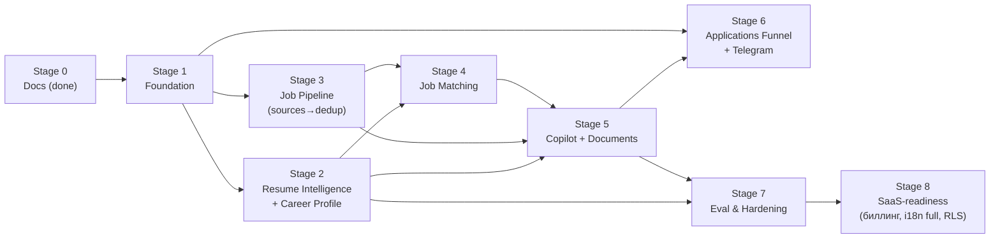

# CareerPilot AI — Roadmap

- **Статус:** Draft v1.0 (Stage 0 — проектирование).
- **Связанные:** все документы docs/; этапы ссылаются на них.
- Оценки трудоёмкости не даются намеренно (личный проект); порядок и зависимости — главное.

---

## 0. Карта этапов и зависимостей

Stage 2 и Stage 3 можно вести параллельно после Stage 1 (независимы до Stage 4).

---

## Stage 0 — Продуктовое определение и архитектура ✅

**Статус:** завершён (этот набор документов).
**Результат:** PRD, ARCHITECTURE, DATABASE, API_SPEC, AI_DESIGN, INTEGRATIONS, EVALUATION, SECURITY, ROADMAP, DECISIONS.

## Stage 1 — Foundation

**Цель:** работающий скелет системы: деплой, CI, аутентификация, базовые процессы разработки.

Объём:

- Монорепо: `backend/`, `frontend/` (каркас), `docker/`, `.github/workflows/`.
- Docker Compose: api, worker-*, db (PG16+pgvector), redis, minio, frontend; профайл `langfuse` (опционально).
- `core`: pydantic-settings конфигурация, structlog-логирование с request_id, иерархия ошибок, middleware, /health /ready.
- `identity`: users + refresh_tokens, Alembic initial migration, auth endpoints (register/login/refresh/logout/me).
- `llm`: каркас LLMClient с мок-провайдером (реальный провайдер — Stage 2), маскирование, `ai_invocations` (схема+запись).
- CI: lint (ruff/mypy), unit, integration (testcontainers), OpenAPI-генерация.
- Фронтенд: каркас приложения (роутинг, auth-флоу, дизайн-система shadcn, i18n-структура ru/en).

**Критерии выхода:** `docker compose up` → регистрация/вход в UI; CI зелёный на всех коммитах; OpenAPI-схема публикуется артефактом; логи JSON с request_id.

## Stage 2 — Resume Intelligence + Career Profile

**Цель:** UJ-1 полностью: резюме → подтверждённые факты → профиль с hard filters.

Объём:

- Загрузка файлов (S3, приватность, лимиты), статусы парсинга.
- Пайплайн Profile Analyzer ([AI_DESIGN §3](AI_DESIGN.md)): детерминированное извлечение текста, LLM-извлечение фактов, evidence binding, нормализация навыков (seed-справочник).
- UI обзора/подтверждения фактов; ручное добавление; редактирование с версионированием (superseded).
- `career_profile` CRUD + hard filters (валидация схем), активация профиля.
- Первый реальный LLM-провайдер + маршрутизация ролей + Langfuse-интеграция (fail-open) + cost tracking.
- **Evaluation:** датасет `resume_extraction` (первые ≥ 10 резюме), harness (`make eval`), baseline зафиксирован; кассеты для интеграционных тестов.

**Критерии выхода:** на своём резюме — факты с цитатами, подтверждение, профиль активен; метрики extraction на датасете ≥ базовых порогов-гипотез (иначе — итерация промптов до выхода с этапа).

## Stage 3 — Job Pipeline (sources → normalization → dedup)

**Цель:** вакансии собираются, нормализуются, дедуплицируются, верифицируются; лента вакансий в UI.

Объём:

- `job_sourcing`: реестр источников, Source Adapter contract, rate limiting (Redis), health.
- Адаптеры первой волны ([INTEGRATIONS §2](INTEGRATIONS.md)): Arbeitnow, Remotive → затем Adzuna, HN Algolia (Algolia API). ATS-борды — после проверки ToS.
- `job_normalization` (posting upsert, нормализация полей, структурирование описания), `job_dedup` (exact fingerprint, merge rules, job_versions).
- `job_discovery`: job_searches + планировщик (Celery beat), ручные запуски, search_runs; recheck/verification.
- API: /jobs, /jobs/{id}, /versions, /sources, /job-searches; UI ленты вакансий.
- **Evaluation:** датасеты `job_normalization`, `job_dedup`.

**Критерии выхода:** ≥ 2 источника стабильно опрашиваются по расписанию без блокировок; дубликаты схлопываются; изменение описания вакансии видно в версиях.

## Stage 4 — Job Matching

**Цель:** объяснимые матчи с hard filters и skill gaps (UJ-3).

Объём:

- Эмбеддинги вакансий (job_embeddings, HNSW), гибридный retrieval (FTS+RRF), job_analyzer (разбор требований, кэш).
- Движок скора: hard filters → компоненты → final_score; explanation-рендер; skill gaps.
- API /matches + решения пользователя; события `facts.changed` → пересчёт матчей.
- **Evaluation:** датасеты `job_retrieval`, `job_matching` (разметка владельцем), baseline; сбор human agreement начинается с первого дня использования.

**Критерии выхода:** на живых вакансиях матчи правдоподобны; нарушенные hard filters не появляются в выдаче; объяснения указывают fact_ids; метрики retrieval/matching зафиксированы.

## Stage 5 — Application Copilot

**Цель:** UJ-4 полностью: LangGraph workflow от анализа вакансии до одобренных материалов.

Объём:

- LangGraph граф ([AI_DESIGN §6](AI_DESIGN.md)) с PostgresSaver; copilot_runs; interrupt/resume API; отмена/перезапуск.
- Генераторы (resume/cover letter/answers), fact_checker, версии документов, ревью-UI с diff, регенерация по фидбеку.
- Экспорт md/docx (pdf — опция); событие materials_ready.
- Приложения-минимум: создание application, статусы draft→materials_ready.
- **Evaluation:** датасеты `generation`, `prompt_injection`; LLM-judge калибровка на ≥ 50 кейсов.

**Критерии выхода:** полный цикл на реальной вакансии; workflow переживает рестарт и суточное ожидание ответа; unsupported claims rate на датасете ≤ порога; ни один документ не одобряется без пройденного fact check.

## Stage 6 — Applications Funnel + Notifications (Telegram)

**Цель:** UJ-5, UJ-6: воронка, статусы, напоминания, Telegram.

Объём:

- Статусы applications (полный автомат), история переходов, воронка/статистика, follow-up напоминания.
- Telegram-бот: линкинг кодом, уведомления (сильные матчи, вопросы копайлота, материалы готовы, напоминания), настройки каналов; in-app список.
- Дайджесты (ежедневно/еженедельно), quiet hours.
- Верификация свежести: полный цикл recheck + статусы closed/stale в UI.

**Критерии выхода:** уведомления доходят и настраиваются; воронка отражает реальность; напоминания создаются по правилам.

## Stage 7 — Evaluation & Hardening

**Цель:** качество под контролем, система устойчива.

Объём:

- Полная CI-карта гейтов ([EVALUATION §7](EVALUATION.md)): eval.yml на PR с изменениями AI, nightly полные сюиты, e2e Playwright.
- Cost-дашборды по ai_invocations; бюджеты и алерты по превышению.
- RLS включение (`CP_DB_RLS_ENABLED`), retention-задачи (§DATABASE 6), бэкапы + restore-рунбук.
- Нагрузочная прикидка (листинги, ingestion), тюнинг индексов/HNSW по измерениям.
- Similarity-dedup (флаг) — если решено включать.

**Критерии выхода:** regression-гейты блокируют деградацию метрик; восстановление из бэкапа протестировано; расходы видны и в бюджете-гипотезе.

## Stage 8 — SaaS-readiness (отложено, архитектурно готово)

- Мульти-пользовательский онбординг, email-верификация, OAuth, 2FA.
- Subscription & Usage: активация квот (usage_records уже пишутся), платёжный провайдер.
- i18n полный (все тексты через словари, перевод en/ru), локализация генерации.
- Публичный деплой (облако), мониторинг/алерты (Sentry/Prometheus), runbook'и, SOC-подобные процессы — по необходимости.
- Расширение источников: решение по hh.ru платному доступу, ATS-борды per-company, новые площадки с официальными API.

---

## Правила перехода между этапами

1. Этап закрыт, когда выполнены **критерии выхода**, а не когда «почти готово».
2. Любой AI-функционал входит в этап вместе со своим evaluation-набором и baseline (см. [EVALUATION.md](EVALUATION.md) §1).
3. Изменения архитектурных решений — только через новый ADR в [DECISIONS.md](DECISIONS.md).
4. Горизонтальные улучшения (рефакторинг, зависимости) — внутри этапов, отдельными PR.

## Основные риски плана

| Риск этапа | Митигция |
|---|---|
| S2: качество extraction ниже порога | итерации промптов/моделей по harness; деградация UX не допускается (факты без evidence отбрасываются всегда) |
| S3: блокировка/изменение API источников | изоляция адаптеров, health, быстрое отключение источника флагом |
| S4: метрики retrieval неудовлетворительны | тюнинг RRF/весов, включение reranker (флаг), расширение датасета |
| S5: latency/cost генерации выше бюджета | маршрутизация моделей, кэширование job_analyzer, лимиты run |
| S6: Telegram-спам | дайджесты, quiet hours, per-type подписки |
