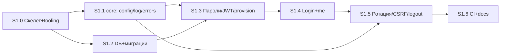

# CareerPilot AI — Stage 1 Implementation Plan (Backend Foundation)

- **Статус:** Draft v1.1 — обновлён по ревью владельца (решения Q-1…Q-8 внесены); реализация не начата, ожидаю финального утверждения.
- **База:** коммит `35f0883` (Stage 0.2). План сверён с фактическим содержимым ARCHITECTURE, SECURITY, DATABASE, API_SPEC, DECISIONS, EVALUATION, INTEGRATIONS, ROADMAP.
- **Ограничения учтены:** без кода на этапе планирования; без Celery/LangGraph/Langfuse; без микросервисов/K8s/Kafka/ES; без ослабления security-контрактов; без grace period; refresh не в localStorage; без push/коммитов до подтверждения.

---

## 1. Цель Stage 1

Минимальный, но качественный **backend foundation**: работающее приложение FastAPI с конфигурацией, структурным логированием, единой обработкой ошибок, PostgreSQL + Alembic, модулем `identity` (login / refresh-ротация / logout / users/me, регистрация закрыта по умолчанию, provisioning владельца), security-integration-тестами, Docker Compose для локальной разработки и CI. Фундамент, на котором Stage 2+ наращивает модули без рефакторинга ядра.

## 2. Scope

### 2.1 In scope

1. Структура backend-проекта (монорепо `backend/`).
2. Python 3.12+, FastAPI, Pydantic v2 (pydantic-settings).
3. Конфигурация: env-переменные с префиксом `CP_`, fail-fast на неизвестные/невалидные.
4. Structured logging (structlog, JSON, request_id) + PII-редакция.
5. Единая обработка ошибок (иерархия AppError, формат `{"error": {...}}`, локализация ru/en).
6. PostgreSQL + SQLAlchemy 2 (async, asyncpg) + Alembic.
7. Модуль `identity`: users, refresh_tokens, audit_subjects, audit_events.
8. `POST /auth/register` — реализован, но закрыт флагом `CP_ALLOW_REGISTRATION=false` (default) → `403 registration_disabled`.
9. Owner provisioning: CLI-скрипт создания владельца.
10. Login, refresh-ротация (атомарный claim, reuse → массовый отзыв), logout (два режима), смена пароля, `GET/PATCH /users/me`.
11. Security integration tests (ротация/конкурентность, CSRF, изоляция, rate limits, PII в логах).
12. Docker Compose: `api`, `db`, `redis` (+ healthchecks). **Redis обоснован:** rate limiting auth-эндпоинтов — контракт SECURITY §2; иного применения в Stage 1 нет.
13. GitHub Actions CI: ruff + mypy → миграции → тесты (PostgreSQL/Redis services) → OpenAPI-артефакт → docker build.

### 2.2 Out of scope (осознанно)

Frontend (любой), Telegram, Celery/воркеры/beat, LangGraph, Langfuse, `llm`-каркас, S3/MinIO и загрузка файлов, экспорт/удаление аккаунта (нет компенсирующих задач), RLS (Stage 7), OAuth/2FA/email-верификация, биллинг, всё, что относится к Stage 2+.

### 2.3 Отклонения от ROADMAP Stage 1 — РЕШЕНО ВЛАДЕЛЬЦЕМ (ревью плана, Q-1: APPROVED)

| # | ROADMAP Stage 1 говорит | Решение (внесено в план) | Обоснование |
|---|---|---|---|
| D-1 | «Фронтенд: каркас приложения» и критерий выхода «регистрация/вход в UI» | Перенести frontend-каркас в Stage 2; критерий выхода заменить на HTTP-проверки (curl/pytest) | Frontend не нужен для завершения backend foundation; ваше ТЗ это прямо предписывает. ROADMAP обновим после утверждения плана |
| D-2 | «`llm`: каркас LLMClient с мок-провайдером, ai_invocations» | Перенести в Stage 2 | Не требуется для auth-foundation; в Stage 1 нет LLM-вызовов. Пустые модули запрещены вашим же ограничением |
| D-3 | Compose: worker-pipeline/ai/notify, beat, minio | В Stage 1 compose = `api` + `db` + `redis` | Без Celery (запрещён на этом этапе) воркеры/beat не нужны; без загрузки файлов не нужен MinIO. ROADMAP-топология останется целевой для Stage 2+ |

## 3. Предлагаемая структура каталогов

```
ai-career-pilot/
├── backend/
│   ├── app/
│   │   ├── main.py                    # фабрика FastAPI: middleware, routers, handlers
│   │   ├── core/
│   │   │   ├── config.py              # pydantic-settings (CP_*, fail-fast)
│   │   │   ├── logging.py             # structlog: JSON, requestId, redaction-процессор
│   │   │   ├── db.py                  # async engine + session factory + Base (naming convention)
│   │   │   ├── errors.py              # AppError-иерархия + handlers → единый формат
│   │   │   ├── i18n.py                # каталог сообщений ru/en по кодам ошибок
│   │   │   ├── middleware.py          # RequestID, access-log, security headers
│   │   │   ├── ratelimit.py           # Redis: fixed-window per-IP/per-account (ключи sha256), 429+Retry-After, fail-closed
│   │   │   └── security/
│   │   │       ├── jwt.py             # HS256 encode/decode (sub/iat/exp/jti/locale)
│   │   │       ├── passwords.py       # argon2-cffi (m=19MiB,t=2,p=1), политика 10–128 + denylist
│   │   │       └── cookies.py         # set/read cp_refresh; attrs из конфига
│   │   └── modules/
│   │       └── identity/
│   │           ├── api/
│   │           │   ├── router.py      # /api/v1/auth/*, /api/v1/users/me
│   │           │   ├── schemas.py     # Pydantic DTO, camelCase-alias
│   │           │   └── deps.py        # get_current_user, get_session, origin_guard
│   │           ├── service.py         # login/rotate/logout/change_password/provision
│   │           ├── repository.py      # users/refresh_tokens/audit (без update/delete для audit)
│   │           └── models.py          # SQLAlchemy-модели 4 таблиц
│   ├── alembic/
│   │   ├── env.py                     # async, metadata из app
│   │   └── versions/
│   │       ├── 0001_initial.py        # users, refresh_tokens, audit_subjects, audit_events
│   │       └── 0002_indexes_enums.py  # (если нужно дробление; иначе в 0001)
│   ├── scripts/
│   │   └── provision_owner.py         # CLI: создать/обновить владельца (идемпотент по email)
│   ├── tests/
│   │   ├── conftest.py                # testcontainers PG/Redis (или CP_TEST_* env), fixtures
│   │   ├── unit/                      # jwt, passwords, config, errors, cookies, ratelimit-логика
│   │   └── integration/
│   │       ├── test_auth_flows.py     # register/login/me/password
│   │       ├── test_refresh_rotation.py  # конкурентность, reuse, expiry, инвариант
│   │       ├── test_csrf_logout.py    # Origin/Referer, logout в двух режимах
│   │       ├── test_isolation.py      # межпользовательская матрица
│   │       ├── test_rate_limit.py
│   │       ├── test_audit.py
│   │       ├── test_migrations.py     # upgrade head/downgrade base, naming conventions
│   │       └── test_logging_redaction.py
│   ├── pyproject.toml                 # deps + ruff/mypy/pytest config
│   ├── uv.lock                        # lockfile (uv)
│   ├── Dockerfile
│   └── .env.example
├── docker/
│   └── docker-compose.yml             # api, db, redis (+healthchecks); профили расширения Stage 2+
├── .github/workflows/ci.yml
├── Makefile                           # dev/run/test/lint/migrate короткие цели
└── docs/
```

Другие модули (`career_profile`, `job_*`, `copilot`, …) **не создаются** — появятся в своих этапах (ограничение «без пустых модулей»).

## 4. Архитектура backend

### 4.1 Слои внутри модуля (identity — эталон для будущих)

```
api (router + schemas + deps)   → HTTP: валидация DTO, auth-зависимости, статус-коды
service (service.py)            → бизнес-логика: транзакционные сценарии, инварианты, аудит
repository (repository.py)      → SQL: запросы/запись, ничего про HTTP
models (models.py)              → SQLAlchemy-таблицы модуля
```

Правила зависимостей: `api → service → repository → models`; обратные запрещены; `api` не делает SQL, `service` не импортирует FastAPI, `repository` не знает ошибок HTTP (кидает доменные исключения). `core` и `modules/*` — единственные верхнеуровневые пакеты (соответствует ARCHITECTURE §4; пакеты `llm`/`workers` появятся позже).

**Обоснование прослоек (каждая минимальна):** отдельный `service` нужен, потому что логика ротации/reuse-детекции — транзакционный сценарий, который вызывается и из API, и из provisioning-скрипта; `repository` изолирует SQL для тестируемости и будущих правил границ модулей; отдельных domain-сущностей (DTO aside) нет — для auth-CRUD это была бы избыточная абстракция.

### 4.2 Управление транзакциями

- Один async-session на HTTP-запрос: dependency `get_session` (commit при успехе, rollback при исключении).
- Ротация refresh — **одна транзакция**: `UPDATE refresh_tokens SET revoked_at=now() WHERE token_hash=:h AND revoked_at IS NULL AND expires_at>now() RETURNING …` → INSERT нового токена → INSERT audit — единый commit (атомарный claim из SECURITY §2).
- Аудит пишется в транзакции действия (append-only; у репозитория нет update/delete для audit-таблиц).
- Provisioning владельца — собственная короткая транзакция скрипта.

### 4.3 Конфигурация

`CP_`-переменные (частичный список, полный — в `.env.example`): `CP_APP_ENV`, `CP_DATABASE_URL`, `CP_REDIS_URL`, `CP_JWT_SECRET` (≥32 байт, fail-fast), `CP_ACCESS_TTL_SECONDS=900`, `CP_REFRESH_TTL_DAYS=30`, `CP_ALLOW_REGISTRATION=false`, `CP_ALLOWED_ORIGIN`, `CP_COOKIE_SECURE=true`, `CP_RATE_LIMIT_*` (окна/лимиты), `CP_LOG_LEVEL`, `CP_LOG_FORMAT=json|console`. Неизвестные переменные с префиксом `CP_` и невалидные значения → отказ старта (ARCHITECTURE §9). **Startup validation (Q-5):** `CP_COOKIE_SECURE=false` допускается только при `CP_APP_ENV=local`; сочетание `production` + `false` — отказ старта (тест S1.1).

### 4.4 Логирование

structlog; JSON в проде, pretty в dev. Процессоры: requestId (из middleware `X-Request-Id`/генерация), userId (после аутентификации), module, redaction (маскирование значений по ключам `password|token|refresh|authorization|cookie` и паттернам email). Тела запросов/ответов не логируются никогда. Уровни — по ARCHITECTURE §8; auth-события INFO с кодами (`login.success` и т.п. — дублируются в audit_events).

### 4.5 Ошибки

Иерархия из ARCHITECTURE §7.1 (Stage 1 нужны: ValidationError, AuthError → 401 `unauthorized`/`token_reuse_detected`, ForbiddenError 403 `forbidden`/`registration_disabled`, RateLimitError 429 `rate_limited`, NotFoundError 404, ConflictError 409, InternalError 500). Формат ответа: `{"error": {"code", "message", "details", "requestId"}}`; message — по `Accept-Language` (ru/en, каталог в `core/i18n.py`); наружу без стек-трейсов.

### 4.6 Health/readiness

`GET /health` — liveness (200, без зависимостей); `GET /ready` — readiness: `SELECT 1` + Redis `PING` → 200/503. Размещение: корень (вне `/api/v1`) — инфраструктурные пробы не версионируются (решение зафиксировано в плане; в API_SPEC §2.1 пути указаны без префикса).

## 5. Компоненты и ответственность

| Компонент | Ответственность |
|---|---|
| `app/main.py` | Фабрика приложения: настройки, middleware-порядок (RequestID → AccessLog → SecurityHeaders), роутеры, exception-handlers, lifespan (проверка конфига, ping зависимостей) |
| `core/config.py` | Единая точка конфигурации, fail-fast, дефолты гипотез |
| `core/logging.py` | Инициализация structlog, контекст, redaction |
| `core/db.py` | Async-engine, session-factory, `Base` с naming convention (DATABASE §1: `idx_`, `uq_`, `fk_`, `pk_`; snake_case, множественное число) |
| `core/errors.py` + `i18n.py` | Иерархия, маппинг → HTTP, каталог локализованных сообщений |
| `core/middleware.py` | RequestID, access-log (метод/путь/статус/длительность, без тел), security headers |
| `core/ratelimit.py` | Redis fixed-window per-IP/per-account, ключи через sha256 (email/IP в открытом виде не хранятся); enforcement — `429` + `Retry-After`; fail-closed при недоступности Redis; детальная спецификация — §9.3 |
| `core/security/jwt.py` | Выпуск/проверка access-JWT (HS256, claims `sub/iat/exp/jti/locale`, TTL 900 c) |
| `core/security/passwords.py` | Argon2id (m=19 MiB, t=2, p=1), длина 10–128, denylist частых паролей |
| `core/security/cookies.py` | `cp_refresh`: HttpOnly, Secure (флаг), SameSite=Lax, Path=`/api/v1/auth`; сеттер/парсер |
| `identity/api` | Эндпоинты §2.1, DTO camelCase, зависимости `get_current_user`, `origin_guard` |
| `identity/service` | Сценарии: register (flag), login, rotate (claim/reuse/expired), logout (2 режима), change_password (ревок остальных сессий), me, provision |
| `identity/repository` | SQL для users/refresh_tokens/audit; `claim_refresh`, `revoke_all_for_user`, `append_audit` |
| `scripts/provision_owner.py` | CLI: email+пароль из аргументов/env; Argon2; идемпотентен по email (создание или отказ с диагностикой); пишет `user.provisioned` |

## 6. План по подэтапам

Каждый подэтап = отдельный коммит (или 2–3 малых), CI зелёный после каждого.

### S1.0 — Скелет проекта и tooling

- **Цель:** запускаемый каркас + окружение разработки.
- **Задачи:** `pyproject.toml` (uv, ruff, mypy, pytest), `app/main.py` с /health, `Dockerfile`, `docker/docker-compose.yml` (api/db/redis, healthchecks), `.env.example`, `Makefile`, workflow `ci.yml` (lint+type+пустые тесты+build).
- **Изменения:** все файлы из §3, относящиеся к каркасу.
- **Тесты:** smoke: /health 200; config import.
- **Готово:** `docker compose up` поднимает api+db+redis; CI зелёный.

### S1.1 — core: конфигурация, логирование, ошибки

- **Цель:** контракты конфигурации/логов/ошибок.
- **Задачи:** `config.py` (fail-fast: неизвестные `CP_*`, короткий `CP_JWT_SECRET`; startup validation `production`+`CP_COOKIE_SECURE=false` → отказ старта), `logging.py` + middleware, `errors.py`/`i18n.py` + handlers, security headers, /ready (db+redis ping).
- **Тесты (unit):** fail-fast кейсы; **production config validation для `CP_COOKIE_SECURE`** (production+false → отказ; local+false → допускается); формат ошибки (`code/message/requestId`); локализация ru/en; requestId сквозной; redaction (токен/email не попадают в вывод логгера).
- **Готово:** ошибки во всех тестах имеют единый формат; /ready отражает состояние зависимостей.

### S1.2 — БД и миграции

- **Цель:** схема identity по DATABASE §3.1/§3.15.
- **Задачи:** `core/db.py` (async engine/session/Base+naming), `models.py` (4 таблицы, citext email, uuid7 через `uuid6`), Alembic env (async) + `0001_initial`; в миграции — `CREATE EXTENSION IF NOT EXISTS citext` (downgrade: drop таблиц → `DROP EXTENSION IF EXISTS citext`, зависимых объектов нет); права: миграция создаёт роль приложения и выдаёт ей DML на доменные таблицы, но на `audit_events` — только `SELECT`/`INSERT` (`REVOKE UPDATE, DELETE`); каскадное удаление `users` → `refresh_tokens`/`audit_subjects` удаляются, `audit_events` **остаются** (FK-семантика DATABASE §3.15: `actor_subject_id` — plain uuid без FK, осиротевшие subject_id — норма).
- **Тесты (integration):** upgrade head на чистой PG; downgrade base (включая безопасное удаление citext); объекты/индексы соответствуют DATABASE (проверка по information_schema); повторный `upgrade` идемпотентен; **роль приложения не имеет UPDATE/DELETE на `audit_events`** (проверка `has_table_privilege`); **удаление пользователя сохраняет `audit_events`** (каскад-тест).
- **Готово:** миграция поднимается/откатывается на чистой базе; naming conventions соблюдены.

### S1.3 — Пароли, JWT, provisioning

- **Цель:** примитивы безопасности и первый пользователь.
- **Задачи:** `passwords.py` (Argon2id + политика + denylist), `jwt.py` (claims, TTL, ошибки подписи/истечения), `cookies.py`, `scripts/provision_owner.py`.
- **Тесты (unit):** хеш/verify, политика паролей (длина, denylist), JWT claims/экспирация/подпись; (integration): provisioning создаёт пользователя + audit `user.provisioned`, повтор по email → внятная ошибка.
- **Готово:** владелец создаётся скриптом; примитивы покрыты тестами.

### S1.4 — Login и базовые эндпоинты

- **Цель:** рабочий вход + users/me.
- **Задачи:** `/auth/register` (flag → 403), `/auth/login` (rate limits, audit success/failed, Set-Cookie, тело: accessToken/user), `GET/PATCH /users/me`, `PUT /auth/password` (ревок всех refresh, кроме текущей сессии), `get_current_user`.
- **Тесты (integration):** register 403 `registration_disabled`; login ok/wrong-password (401, audit.failed); password-политика на login-ошибке не раскрывает существование email; me возвращает только свои данные; password change инвалидирует другие сессии (семантика §9.2); rate limit 429 c `Retry-After` (без sleep-механизма); PII/токены не в логах.
- **Готово:** полный auth-цикл, кроме refresh-ротации, зелёный.

### S1.5 — Refresh-ротация, CSRF, logout (ядро безопасности)

- **Цель:** контракты ротации/CSRF/logout без ослаблений.
- **Задачи:** `/auth/refresh` (режимы и Origin-guard по §9.1 — решение Q-2; атомарный claim; классификация: expired → 401 `unauthorized`, revoked → reuse → массовый отзыв + audit + 401 `token_reuse_detected`); `/auth/logout` (access-JWT-режим и cookie-режим с ограничением операции).
- **Тесты (integration, acceptance criteria = EVALUATION §2 + ревью владельца):** ① два конкурентных запроса одним токеном: победитель 200+новая пара, проигравший 401 `token_reuse_detected` + все сессии отозваны; ② инвариант ≤1 действующего токена в семье (проверка после гонок и в спокойном цикле); ③ повторное использование ротированного токена → массовый отзыв; ④ logout по refresh-cookie при истёкшем access отзывает сессию; ⑤ **две конкурентные PostgreSQL-транзакции на уровне SQL** (не только HTTP): победитель коммитит ротацию, проигравший видит 0 строк → классифицируется как reuse; ⑥ **атомарность массового отзыва** — одна транзакция «ревок всех активных токенов + audit `refresh.reuse_detected`», частично отозванных состояний не бывает; ⑦ **отсутствие частично выпущенных refresh-токенов после rollback проигравшего** — в БД ровно один действующий токен; ⑧ audit при reuse корректен (событие в транзакции отзыва, subject через audit_subjects); дополнительно: expired-токен ≠ reuse (нет массового отзыва), Origin mismatch/отсутствие (в cookie-режиме) → 403, **неоднозначный запрос (cookie+тело) → cookie-режим с Origin-guard, тело игнорируется**, cookie-атрибуты соответствуют ADR-020, ротация обновляет cookie.
- **Готово:** все AC зелёные; конкурентность проверена и на уровне БД (две параллельные транзакции claim).

### S1.6 — CI-финализация и документация

- **Цель:** воспроизводимость.
- **Задачи:** полный ci.yml (services postgres/redis → alembic upgrade → pytest; job docker build; артефакт openapi.json); README-раздел «Запуск backend» (compose, provision, curl-проверки); при необходимости мелкие правки `.env.example`.
- **Тесты:** CI на пуш-ветку зелёный end-to-end.
- **Готово:** Definition of Done §13 выполнен.

### S1.7 (опционально, после решения D-1) — frontend-каркас

Переносится в Stage 2, если владелец не решит иначе.

## 7. Файлы: появятся / изменятся

**Появятся:** ~35 файлов из §3 (перечень исчерпывается структурой каталогов; пустых файлов не создаём — каждый содержит работающий код/конфиг). **Изменятся:** `README.md` (раздел запуска), `docs/ROADMAP.md` (после утверждения: перенос frontend/llm-каркаса и целевой compose — фиксация отклонений D-1…D-3), `.github/workflows/ci.yml` (создаётся). `docs/STAGE_1_PLAN.md` — этот документ (при утверждении статус → Accepted).

## 8. Database schema и миграции

### 8.1 Таблицы миграции 0001 (строго по DATABASE.md)

| Таблица | Ключевое |
|---|---|
| `users` | id uuid PK (uuid7 app-side), email **citext** UNIQUE, password_hash, display_name, locale (`ru`\|`en`), timezone, is_active, last_login_at, created_at/updated_at |
| `refresh_tokens` | id PK, user_id FK→users **CASCADE**, token_hash UNIQUE (sha256), expires_at, revoked_at, user_agent, ip inet; idx(user), idx(expires_at) |
| `audit_subjects` | subject_id uuid PK (v4 random), user_id FK→users **CASCADE UNIQUE**, created_at |
| `audit_events` | id PK, actor_subject_id uuid **без FK**, action, resource_type/resource_id, ip, user_agent, request_id, context jsonb, created_at; idx(actor_subject_id, created_at DESC), idx(action, created_at DESC); UPDATE/DELETE запрещены на уровне прав роли приложения |

`data_exports` **не создаётся** (эндпоинта экспорта нет в scope; таблица появится вместе с ним — Stage 2+).

### 8.2 Стратегия миграций

Alembic — единственный источник схемы; async env; идентификаторы ревизий человекочитаемые (`0001_initial`); каждая ревизия реверсибельна. Tenant isolation — прикладной уровень (`get_by_id(user_id, …)`), RLS **не включаем** (Stage 7, ADR-021/Q-A4). UUIDv7 — библиотека `uuid6` (ADR-016).

Детали миграций (по ревью владельца):

- **citext:** upgrade — `CREATE EXTENSION IF NOT EXISTS citext`; downgrade — drop 4 таблиц → `DROP EXTENSION IF EXISTS citext` (зависимых объектов не остаётся; в dev/testcontainers база одноразовая; в shared-инстансах расширение общее — удаляем только если создали мы, что гарантирует порядок операций downgrade).
- **`audit_events.actor_subject_id`** — plain uuid **без FK** (DATABASE §3.15): FK заблокировал бы удаление связи или мутировал бы append-only события; каскад удаления пользователя затрагивает только `audit_subjects`/`refresh_tokens`, `audit_events` **сохраняются** (осиротевшие subject_id — норма; тест S1.2).
- **Права роли приложения:** миграция создаёт роль (имя из `CP_DB_APP_ROLE`, default `cp_app`) с DML на доменные таблицы; на `audit_events` — только `SELECT`/`INSERT` (`REVOKE UPDATE, DELETE`); приложение подключается под этой ролью (compose/dev тоже). Каскадные удаления с `users` срабатывают от привилегии на родительскую таблицу — REVOKE не мешает.
- **Образ БД (Q-7):** `postgres:16` (plain). pgvector-образ и расширение появятся на Stage 3–4 вместе с векторным поиском; dev-volume пересоздаётся (данных для сохранения нет).
- Индексы/ограничения — в точности §8.1/DATABASE §3.1, §3.15 (проверка тестом по information_schema/pg_catalog).

## 9. Authentication/security implementation plan

Реализуемые контракты (источник — SECURITY §2, API_SPEC §1.1, ADR-020, ADR-021):

| Контракт | Реализация в Stage 1 |
|---|---|
| Registration disabled | `CP_ALLOW_REGISTRATION=false` (default) → `/auth/register` 403 `registration_disabled`; логика регистрации при этом полностью реализована и покрыта тестом с флагом=true |
| Owner provisioning | CLI-скрипт; audit `user.provisioned` (минимальное расширение каталога SECURITY §11 — см. Q-6) |
| Login | Argon2id verify → access JWT (память клиента) + refresh opaque `rt_<43>`; тело ответа без refresh; Set-Cookie `cp_refresh` |
| Cookie | HttpOnly; Secure (`CP_COOKIE_SECURE=true` default; `false` только для local, production-validation запрещает — Q-5); SameSite=Lax; Path=`/api/v1/auth` |
| Ротация | Атомарный claim в одной транзакции; новая пара; инвариант одного действующего токена; **без grace period** |
| Reuse detection | UPDATE затронул 0 строк и токен существует с `revoked_at IS NOT NULL` → отзыв всех активных сессий пользователя + audit `refresh.reuse_detected` + 401 `token_reuse_detected`; expired (не отозванный) → 401 `unauthorized` без массового отзыва |
| CSRF | SameSite=Lax (cookie-атрибут) + Origin/Referer guard — **только cookie-режим** refresh/logout (решение владельца Q-2); правила режимов и неоднозначных запросов — §9.1; требуемые правки SECURITY/API_SPEC — §15.2 (diff на согласование) |
| Logout | Режим A: access JWT → отзыв refresh из cookie/тела; режим B (access истёк): валидная refresh-cookie + Origin → отзыв только этой сессии |
| Session revocation | `revoke_all_for_user` (reuse, смена пароля); точечный revoke (logout, ротация) |
| Rate limiting | Redis, distributed (Q-4), fail-closed при недоступности (503 — решение владельца); ключи/TTL/lockout/конкурентность — §9.3; audit `login.failed` |
| Безопасные ошибки | Единый формат; login не раскрывает существование email; 404 вместо 403 для чужих ресурсов (проверяется в изоляции-тестах) |

### 9.1 Режимы refresh/logout и Origin-guard (решение Q-2: approved with clarification)

| Режим | Когда действует | Origin/Referer guard |
|---|---|---|
| **cookie-режим** | refresh взят из cookie `cp_refresh`; **присутствие cookie определяет режим** | обязателен: точное совпадение `Origin` (fallback `Referer`) с `CP_ALLOWED_ORIGIN`; несовпадение или отсутствие обоих заголовков → `403` |
| **body-режим** | refresh передан в теле `refreshToken`, **cookie отсутствует** | не требуется (не ambient-credential — CSRF неприменим); режим для CLI/тестов |
| **неоднозначный (cookie и тело одновременно)** | cookie присутствует | обрабатывается как **cookie-режим** с Origin-guard; тело игнорируется + WARNING-лог (аномалия: наш frontend тело никогда не отправляет) |

Приоритет cookie закрывает обход: cross-site злоумышленник не может «переключить» запрос в body-режим, подставив произвольное тело, — cookie всё равно делает запрос cookie-режимом. Поведение обоих режимов однозначно и покрыто тестами (включая неоднозначный кейс ⑧ в S1.5).

### 9.2 Смена пароля (детализация)

- Повторная аутентификация: access JWT + **старый пароль** в теле (API_SPEC §2.2: «старый + новый»); неверный старый → `401` без раскрытия деталей.
- Отзыв сессий: отзываются **все** refresh-сессии пользователя, **кроме текущей** — текущая определяется по refresh из cookie/тела запроса, если предъявлен; refresh не предъявлен → отзываются все (следующий вход заново).
- Текущий access: остаётся валиден ≤ 15 мин (stateless, принято); в ответе выдаётся свежий access.
- Audit: `password.changed`, context `{ "sessionsRevoked": N }` — **без** пароля, хеша и секретов; логи — тоже.

### 9.3 Rate limiting (детализация по ревью)

- **Ключи Redis** (без PII в открытом виде — только sha256): per-IP `cp:rl:auth:ip:{sha256(ip)}` (все auth-эндпоинты, окно 60 c, лимит-гипотеза 30) и `cp:rl:login:ip:{sha256(ip)}` (login, окно 60 c, лимит 10); per-account `cp:rl:acc:{sha256(email_lower)}` — счётчик **неудачных** логинов, TTL 900 c, порог-гипотеза 10 → `429` c `Retry-After` = остаток TTL.
- **Сброс:** успешный логин → `DEL cp:rl:acc:{…}`; IP-окна истекают по TTL.
- **Защита от намеренного lockout:** per-account порог мягкий и автоистекающий (нет вечной блокировки жертвы, нет ручного разблокирования); брутфорс по одному аккаунту ограничен per-account ключом, массовый — per-IP; остаточный риск (ротация IP против одного аккаунта) принят и зафиксирован.
- **Enforcement:** основной механизм — `429` + `Retry-After`; длительные `asyncio.sleep` блокировкой **не являются и не используются**; допустим только микро-jitter ≤ 250 мс как анти-молотилка.
- **Конкурентность счётчиков:** `INCR` + установка TTL при первом инкременте (`EXPIRE NX` / Lua) — атомарно; погрешность ±1 на границе окна принята.
- **Недоступность Redis — fail-closed (решение владельца):** `login`/`refresh`/`register`/`logout` (cookie-режим) → `503` `external_service_error` («аутентификация временно недоступна»); лимиты **не отключаются молча**; `/ready` → 503; `/health` остаётся 200. Обоснование принятого варианта: обратное (fail-open) ослабляет security-контракт, а частичный локальный fallback в memory — скрытая дивергенция лимитов при нескольких инстансах.

**Межвкладочная координация refresh — распределение сторон:** контракт полностью описан в SECURITY §2 (single-flight в вкладке; межвкладочно — Web Locks API с fallback BroadcastChannel/localStorage-мьютекс; неизвестный результат — один повтор; `token_reuse_detected` → переход на логин). **Всё это — ответственность frontend (Stage 2).** Backend обеспечивает: идемпотентность безопасной стороны (reuse → единообразный 401 + отзыв), стабильный код ошибки `token_reuse_detected` для UX-ветки «сессия истекла», отсутствие grace period. В Stage 1 фиксируем эти требования как acceptance-критерии будущего frontend-кода (переносятся в Stage 2 план).

## 10. Тестовая стратегия и acceptance criteria

Стек: pytest + httpx (AsyncClient против приложения), testcontainers (PostgreSQL 16, Redis 7) локально; в CI — те же тесты против services-контейнеров через `CP_TEST_DATABASE_URL`/`CP_TEST_REDIS_URL` (SQLite не используется нигде; PG-specific: citext, inet, транзакционные блокировки). Миграции применяются к тестовой базе до прогона (тестят реальную схему).

| Класс | Что проверяем (критерии приёмки) |
|---|---|
| Unit | JWT (claims/TTL/подпись), пароли (Argon2/политика/denylist), config fail-fast, формат ошибок + i18n, cookie-атрибуты, redaction-процессор |
| API integration | register 403/201(флаг), login 200/401/429, me, password change + ревок сессий, готовность /ready |
| PostgreSQL integration | репозитории на реальной PG; claim-транзакция; FK-каскады (удаление пользователя → refresh_tokens/audit_subjects каскадом, audit_events остаются, subject осиротевший — ожидаемо) |
| Migration | upgrade/downgrade чистой базы; naming conventions; objects == DATABASE §8.1 |
| Refresh rotation concurrency | AC ①–⑧ из S1.5 (вкл. две конкурентные PG-транзакции, атомарность массового отзыва, отсутствие частично выпущенных токенов после rollback, корректный audit при reuse) + expired≠reuse |
| CSRF | cookie-режим refresh/logout: Origin неверный → 403; Referer-fallback; body-режим — по решению Q-2 |
| Tenant isolation | 2 пользователя: me/свои токены/чужие id → 404; cookie A не работает как B |
| Rate limiting | 429 per-IP и per-account с `Retry-After`; успешный логин сбрасывает per-account счётчик; счётчики атомарны при конкурентных запросах; **Redis outage → 503 fail-closed** (лимиты не отключаются молча), `/ready` → 503 |
| Config validation | `CP_APP_ENV=production` + `CP_COOKIE_SECURE=false` → отказ старта; `local` + `false` — допускается (unit) |
| DB privileges & cascades | роль приложения без UPDATE/DELETE на `audit_events` (`has_table_privilege`); удаление пользователя → `refresh_tokens`/`audit_subjects` каскадом, `audit_events` остаются (осиротевший subject_id — норма) |
| OpenAPI determinism | повторная генерация `openapi.json` байт-в-байт идентична (стабильный порядок, без таймстемпов) — CI проверяет |
| Logging/PII | в захваченных логах отсутствуют пароли/токены/email; есть requestId/userId |

Порог: все тесты обязательны в CI; покрытие новых строк `core/identity` ≥ 85 % (гипотеза; не блокирует, но репортится).

## 11. Docker/CI strategy

Compose (dev): `api` (uvicorn, volume-маунт, depends_on: db healthy, redis healthy), `db` (**`postgres:16`** — Q-7: pgvector-образ появится вместе с pgvector на Stage 3–4; healthcheck `pg_isready`, volume), `redis` (`redis:7`, healthcheck). MinIO/воркеры/beat — профили Stage 2+ (не создаются).

CI (`.github/workflows/ci.yml`), триггеры — **`pull_request` и `push` в `main`**:

1. `quality`: python 3.12 + uv (кеш по lockfile) → `ruff check` + `ruff format --check` → `mypy`;
2. `tests`: services `postgres:16` + `redis:7` → `alembic upgrade head` на **чистой** базе → `pytest`: unit + integration + **конкурентность на реальной PostgreSQL** + **Redis-outage** + config-validation;
3. `openapi`: детерминированная генерация `openapi.json` (проверка воспроизводимости байт-в-байт) → артефакт;
4. `build`: `docker build` образа backend.

Никаких деплоев.

## 12. Риски и компромиссы

| Риск/компромисс | Митигция |
|---|---|
| Локальный http и Secure-cookie | `CP_COOKIE_SECURE=true` default; `false` допустим **только** при `CP_APP_ENV=local` — production startup validation запрещает (Q-5) |
| Fail-closed rate limiting: недоступность Redis блокирует auth (503) | Принято владельцем (не отключать молча); `/ready` сигнализирует; осознанная цена контракта |
| Смена `postgres:16` → pgvector-образ на Stage 3–4 | Dev-volume пересоздаётся (данных нет); prod — смена образа без изменения данных |
| testcontainers медленнее in-memory | Параллелизация pytest; CI через services |
| Argon2-параметры «уточнить при реализации» (SECURITY) | Зафиксировать m=19 MiB,t=2,p=1 в Stage 1 и закрыть тестом; пересмотр — отдельным ADR |
| Скудный аудит-каталог (5 событий auth) | Достаточно для Stage 1; расширение — по мере модулей |
| Отсутствие frontend в Stage 1 | Проверки через curl/pytest; UX-рисков нет (единственный пользователь — владелец) |
| denylist паролей | Малый встроенный список top-N; zxcvbn не добавляем (лишняя зависимость) |

## 13. Definition of Done (Stage 1)

1. `docker compose up` → api/db/redis здоровы; /health, /ready отвечают.
2. Владелец создаётся `provision_owner`; `/auth/register` → 403 `registration_disabled`.
3. login → access в теле + refresh в cookie; ротация работает; конкурентные AC ①–④ зелёные.
4. Reuse → массовый отзыв + 401 `token_reuse_detected`; expired → 401 без отзыва.
5. Logout в двух режимах; смена пароля ревокает сессии.
6. Rate limits работают (429 + `Retry-After`; Redis outage → 503 fail-closed); CSRF-guard cookie-режима (включая неоднозначные cookie+body запросы → cookie-режим); production-validation запрещает `CP_COOKIE_SECURE=false`; ошибки в едином формате с локализацией.
7. Логи JSON с requestId; тест redaction зелёный; секретов/PII в логах нет.
8. Миграции поднимаются/откатываются (включая безопасный citext-downgrade); схема == DATABASE §8.1; роль приложения не имеет UPDATE/DELETE на `audit_events`; audit-события переживают удаление пользователя.
9. CI: lint/type/tests/migrations/build зелёные; openapi.json — артефакт.
10. Решения владельца Q-1…Q-8 учтены в реализации; ROADMAP (перенос frontend/llm/workers в Stage 2) и правки Q-2 по §15.2 — первым коммитом Stage 1 после финального утверждения плана.

## 14. Зависимости между подэтапами



S1.1 и S1.2 параллелизуемы; S1.5 требует и S1.4, и origin-guard из S1.1; каждый следующий подэтап — маленькие коммиты поверх зелёного CI.

## 15. Решения владельца по итогам ревью плана (Q-1…Q-8)

| # | Вопрос | Решение владельца | Как отражено в плане |
|---|---|---|---|
| Q-1 | Отклонения D-1…D-3 от ROADMAP (frontend/llm/workers/MinIO → Stage 2; compose = api+PG+Redis) | **APPROVED** | §2.1–§2.3, §11; ROADMAP обновляется первым коммитом Stage 1 (не сейчас) |
| Q-2 | Origin/Referer guard: cookie vs body режимы; правило для неоднозначных запросов | **APPROVED WITH CLARIFICATION**: guard обязателен для cookie-based refresh/logout; для refresh в body — не обязателен; неоднозначный запрос (оба источника) — определить и документировать | §9.1: **cookie имеет приоритет** (присутствие cookie определяет режим; тело игнорируется + WARNING); однозначное поведение в обоих режимах; правки SECURITY/API_SPEC — §15.2 (на согласование) |
| Q-3 | `PUT /auth/password`, `PATCH /users/me` | **APPROVED** | §2.1, S1.4, §9.2 |
| Q-4 | Redis для distributed auth rate limiting | **APPROVED** | §9.3 (ключи/TTL/lockout/конкурентность), compose/CI |
| Q-5 | `CP_COOKIE_SECURE=true` default; production запрещает false | **APPROVED** | §4.3 (startup validation), S1.1-тесты, §12 |
| Q-6 | audit `user.provisioned` без секретов и лишних PII | **APPROVED** | S1.3 (context: только идентификаторы) |
| Q-7 | uv + lockfile — да; pgvector-образ — нет | **PARTIALLY APPROVED** | §8.2/§11: `postgres:16`; pgvector-образ на Stage 3–4 |
| Q-8 | /health, /ready вне `/api/v1` | **APPROVED** | §4.6 |

### 15.1 Оставшиеся вопросы

| # | Вопрос | Что нужно |
|---|---|---|
| R-1 | Финальное утверждение обновлённого плана | Подтверждение владельца → статус плана Accepted, старт S1.0 |
| R-2 | Согласование документальных правок Q-2 (§15.2) | Одобрение diff → применяются в первом коммите Stage 1 вместе с ROADMAP-правками (D-1…D-3) |
| R-3 | Значения-гипотезы rate-limit (30/мин auth, 10/мин login, 10 неудач/15 мин) | Не блокируют старт; калибруются при эксплуатации |

### 15.2 Документальные изменения на согласование (Q-2) — точный diff

**Файл 1: `docs/SECURITY.md`, §2, буллет «CSRF».**

```diff
- - **CSRF (только cookie-аутентифицированные операции):** ① `SameSite=Lax` — cookie не отправляется на cross-site POST; ② **Origin/Referer validation** на `/auth/refresh` и `/auth/logout`: точное сравнение `Origin` (fallback — `Referer`) с разрешённым origin из конфигурации; несовпадение или отсутствие обоих заголовков → `403`. Ротация refresh — механизм защиты **сессий**, а не CSRF, и эшелоном CSRF-защиты не считается (см. ниже). Заголовкам прокси (`X-Forwarded-*`, `Origin` при терминации TLS) доверяем только от настроенных доверенных reverse proxy — иначе клиентский IP для троттлинга/аудита подделываем.
+ - **CSRF (только cookie-режим `/auth/refresh`, `/auth/logout`):** ① `SameSite=Lax` — cookie не отправляется на cross-site POST; ② **Origin/Referer validation** — точное сравнение `Origin` (fallback — `Referer`) с разрешённым origin из конфигурации; несовпадение или отсутствие обоих заголовков → `403`. Guard применяется **только когда refresh взят из cookie** (ambient-credential → CSRF применим); body-режим (refresh явно передан в теле — CLI/тесты) Origin-проверки не требует. Неоднозначный запрос (есть и cookie, и тело): **cookie имеет приоритет** — запрос обрабатывается как cookie-режим с Origin-проверкой, тело игнорируется (WARNING-лог; frontend тело никогда не отправляет). Ротация refresh — механизм защиты **сессий**, а не CSRF, и эшелоном CSRF-защиты не считается (см. ниже). Заголовкам прокси (`X-Forwarded-*`, `Origin` при терминации TLS) доверяем только от настроенных доверенных reverse proxy — иначе клиентский IP для троттлинга/аудита подделываем.
```

**Файл 2: `docs/API_SPEC.md`, §1.1, абзац «CSRF».**

```diff
- CSRF (cookie-аутентифицированные операции `refresh`/`logout`): `SameSite=Lax` + **валидация `Origin`** (fallback `Referer`) против разрешённого origin — точное сравнение; несовпадение или отсутствие обоих заголовков → `403` (детали — [ADR-020](DECISIONS.md), [SECURITY.md](SECURITY.md) §2).
+ CSRF (cookie-режим `refresh`/`logout`): `SameSite=Lax` + **валидация `Origin`** (fallback `Referer`) против разрешённого origin — точное сравнение; несовпадение или отсутствие обоих заголовков → `403`. Guard применяется только в cookie-режиме; body-режим (`refreshToken` в теле, cookie отсутствует) — без Origin-проверки; при наличии обоих источников cookie имеет приоритет, тело игнорируется (детали — [ADR-020](DECISIONS.md), [SECURITY.md](SECURITY.md) §2).
```

Оба изменения не ослабляют защиту (cookie-режим полностью сохраняет guard; приоритет cookie закрывает обход через подстановку тела) и не требуют новых ADR — это уточнение реализации решения ADR-020. **Пока не применены** — ожидают согласования вместе с планом.

## 16. Само-аудит плана (соответствие ограничениям)

- ADR не меняются: архитектура (monolith — ADR-001), стек (ADR-002), токены (ADR-020 — реализация, не пересмотр), secrets env-first (ADR-013), uuid6 (ADR-016), режимы MVP (ADR-021). ✅
- **Решения владельца Q-1…Q-8 внесены во все разделы плана** (§2.3, §4.3, §8.2, §9.1–9.3, §11–§13); ничего не принято молча. ✅
- Security-контракты не ослаблены: ротация без grace period, refresh не в localStorage (cookie — сторона backend), reuse → массовый отзыв, CSRF guard cookie-режима (приоритет cookie при неоднозначности), rate limiting fail-closed, PII-редакция. Уточнение Q-2 оформлено как diff на согласование (§15.2) и к SECURITY/API_SPEC **не применено**. ✅
- Функции будущих этапов не протекают: нет Celery/LangGraph/Langfuse/llm/S3/RLS/export; `data_exports` не создаётся. Отклонения от ROADMAP (D-1…D-3) одобрены владельцем; ROADMAP обновляется первым коммитом Stage 1. ✅
- Лишние зависимости отсутствуют: минимальный набор (fastapi, sqlalchemy, asyncpg, alembic, pydantic-settings, structlog, argon2-cffi, pyjwt, uuid6, redis, httpx/pytest/testcontainers — dev); образ БД — plain `postgres:16` (Q-7). ✅
- План декомпозирован на малые подэтапы S1.0–S1.6 (каждый — небольшие коммиты) с зелёным CI после каждого. ✅
- Acceptance criteria объективны: таблица §10 (вкл. AC ①–⑧ ротации, Redis-outage, config-validation, privileges, OpenAPI-детерминизм) + DoD §13 проверяются командами CI/pytest без интерпретаций. ✅
