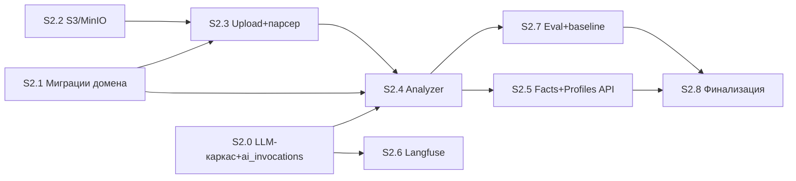

# CareerPilot AI — Stage 2 Implementation Plan (Resume Intelligence + Career Profile)

- **Статус:** Draft v1.0 — план на ревью у владельца; реализация не начата.
- **База:** HEAD `c15b080` (Stage 1 завершён: S1.0–S1.6, CI зелёный, 116 тестов).
- План сверен с фактическими файлами: ROADMAP (Stage 2), AI_DESIGN §2/§3/§8/§9/§10, DATABASE §3.2–3.4/§3.12/§5/§6, SECURITY §2/§4/§6.1/§7/§8/§11, API_SPEC §1/§2.3/§2.4/§4/§8, EVALUATION §2/§4, DECISIONS ADR-003/004/011/013/016/021.
- **Backend-only** (frontend-каркас — отдельный трек вне Stage 2, решение Q-1 владельца из ревью Stage 1-плана).

---

## 1. Цель Stage 2

UJ-1 (PRD): пользователь загружает резюме (PDF/DOCX) → система извлекает структурированные факты с цитатами-evidence → пользователь подтверждает/правит/добавляет факты → создаётся Career Profile с hard filters и активируется. Всё — **без** matching, copilot, источников вакансий (Stage 3–5).

Дополнительно закладывается LLM-инфраструктура (LLMClient + провайдеры + ai_invocations + Langfuse fail-open) и evaluation-harness с baseline-метриками extraction — фундамент всех AI-этапов.

## 2. Scope

### 2.1 In scope

1. **S3/MinIO**: приватный bucket, presigned URL TTL ≤ 15 мин, ключи `users/{uid}/resumes/{id}/{sanitized-filename}`, удаление объектов.
2. **Загрузка файлов**: multipart POST /resumes, magic-bytes проверка (PDF `%PDF-`, DOCX `PK`+OOXML), лимит 15 МБ, лимит распакованного объёма/записей (zip-bomb), filename-санитизация сервером, checksum-дедуп (`uq_resumes_user_checksum`).
3. **Парсинг в изолированном subprocess** (SECURITY §6.1): allowlist окружения (без секретов), rlimits CPU/mem + wall-time, выделенный temp-каталог с очисткой, XXE-off, ZIP-traversal-check. Честно: **сетевой изоляции subprocess нет** (остаточный риск задокументирован; полное сетевое разделение — SaaS-усиление).
4. **Profile Analyzer** (AI_DESIGN §3): детерминированная фаза (текст, секции) → LLM-извлечение (structured output) → детерминированная постобработка: нормализация навыков (seed-справочник), evidence binding (факт без подтверждённой цитаты отбрасывается), confidence gating, дедуп/слияние → `profile_facts status=draft`.
5. **Facts API**: GET/POST `/career-profiles/{id}/facts`, PATCH `/facts/{id}` (confirm/edit/reject + `expectedUpdatedAt`), оптимистичная блокировка.
6. **Career Profiles CRUD**: POST/GET /career-profiles, GET/PATCH/DELETE /{id}, POST /{id}/activate; hard filters по схеме DATABASE §3.2.1; один активный (partial unique).
7. **LLM-каркас** (`app/llm/`): LLMClient Protocol, Mock-провайдер (детерминированный, кассеты), structured outputs (Pydantic + retry на невалидный JSON), routing (роль→модель через конфиг), ai_invocations (tokens/cost/latency/trace_id — независимо от Langfuse), MaskingPolicy.
8. **Langfuse fail-open** (ADR-011): обёртка трассировки; STRICT по умолчанию — метаданные без user_id/полных текстов; недоступность не влияет на продукт. Включение — Q-3.
9. **Evaluation**: датасет `resume_extraction` (≥10 резюме, JSONL в git), harness `make eval`, baseline зафиксирован в `eval/baselines.json` (EVALUATION §5). Реальный LLM-провайдер — Q-4.
10. **Выполнение пайплайна**: без Celery — asyncio background task + статусы в `resumes.status` + ограничение параллелизма (Semaphore); API отдаёт 202 и статус поллится.

### 2.2 Out of scope (осознанно)

- Job discovery/sources/matching/copilot (Stage 3–5); pgvector + embeddings (Stage 4; `embed()` не реализуем пустым — Q-7); LangGraph (Profile Analyzer — линейный пайплайн); Celery (нет retry-задач; переоценка в Stage 3); frontend; `evaluation_*` таблицы (датасеты в git по EVALUATION §1; реестр прогонов в БД — Stage 3+, когда появятся CI-прогоны); реальный DOCX→текст рендер сложных макетов (только текстовый слой; сканы — вежливая ошибка `parse_notext`); OCR.

## 3. Структура каталогов (новое)

```
backend/
├── app/
│   ├── llm/                          # AI Observability & Evaluation, часть 1 (ARCHITECTURE §4)
│   │   ├── client.py                 # LLMClient: complete() -> Completion; routing+fallback
│   │   ├── providers/
│   │   │   ├── base.py               # Provider Protocol
│   │   │   └── mock.py               # детерминированный Mock (кассеты/шаблоны по входному хешу)
│   │   ├── schemas.py                # Structured-output Pydantic-схемы (FactsExtraction и др.)
│   │   ├── prompts/                  # локальные версии промптов (fallback; git — источник правды)
│   │   │   └── resume_extraction.v1.md
│   │   ├── masking.py                # MaskingPolicy STRICT/DEBUG_CONTENT (AI_DESIGN §9.3)
│   │   ├── observability.py          # Langfuse fail-open обёртка (S2.6)
│   │   └── invocations.py            # запись ai_invocations (транзакция вызова)
│   ├── modules/
│   │   ├── resume_intelligence/
│   │   │   ├── api/{router,schemas}.py   # /resumes CRUD, file, reparse; facts GET/PATCH
│   │   │   ├── service.py            # upload, parse orchestration, facts confirm/edit/reject
│   │   │   ├── analyzer/
│   │   │   │   ├── pipeline.py       # детерминированное → LLM → постобработка
│   │   │   │   ├── evidence.py       # evidence binding (нечувствительное сопоставление цитат)
│   │   │   │   ├── normalize.py      # seed-справочник навыков (data/skills.csv)
│   │   │   │   └── dedup.py          # слияние дублей (тип+канон.значение+период)
│   │   │   ├── parser/
│   │   │   │   ├── runner.py         # asyncio.create_subprocess_exec + env allowlist + rlimits
│   │   │   │   └── worker.py         # standalone-скрипт парсинга (запускается в subprocess)
│   │   │   ├── repository.py         # resumes, profile_facts
│   │   │   └── models.py             # Resume, ProfileFact (импорт в alembic metadata)
│   │   └── career_profile/
│   │       ├── api/{router,schemas}.py   # /career-profiles CRUD + activate + hard filters
│   │       ├── service.py            # валидация hard_filters, activate (один активный)
│   │       ├── repository.py
│   │       └── models.py             # CareerProfile
├── data/skills.csv                   # seed-справочник (skill_id,name,category,synonyms)
├── eval/
│   ├── datasets/resume_extraction/*.jsonl
│   ├── baselines.json
│   └── run_extract_eval.py           # harness (make eval)
└── tests/ (unit/integration по модулям + fixtures с кассетами Mock)
docker/docker-compose.yml             # +minio (Q-6)
.github/workflows/ci.yml              # tests +minio service; eval-job — Q-4
Makefile                              # +eval
docs/STAGE_2_PLAN.md                  # этот план
```

## 4. Архитектура

### 4.1 Слои

Как в identity (STAGE_1_PLAN §4.1): `api → service → repository → models`; `llm/` — общая инфраструктура (вызывается только из service-слоёв). Новый модуль не лезет в чужие таблицы: resume_intelligence владеет resumes/profile_facts; career_profile — career_profiles; факты профиля читаются через публичный API модуля career_profile (service-вызов), запись — resume_intelligence.

### 4.2 Где живёт парсер

**Subprocess из API-процесса** (не отдельный worker-сервис): `asyncio.create_subprocess_exec(sys.executable, "-m", "app.modules.resume_intelligence.parser.worker", tmp_path, ...)` с `env=ALLOWLIST` (PATH, LC_ALL, TMPDIR), `preexec_fn` → `resource.setrlimit` (CPU 10 s, AS 512 MiB, FSIZE), `timeout=60` (wait_for → kill). Вход/выход — файлы в выделенном temp-каталоге задачи (`tempfile.mkdtemp` под корнем temp), очистка в `finally`. Почему не отдельный worker-процесс-сервис: Personal MVP без Celery (Q-ответ Stage 1: перенос Celery в Stage 3); subprocess уже даёт главное — секреты не попадают в окружение парсера. Отдельный контейнер с network policy — SaaS-усиление (зафиксировано).

### 4.3 Где живёт LLM-вызов

Upload-эндпоинт синхронно делает только: валидации → S3 put → INSERT resume(status=uploaded) + audit → enqueue background task → 202. Background task (`asyncio.create_task` через FastAPI BackgroundTasks): status=parsing → subprocess-парсинг → LLM-извлечение (через LLMClient, Semaphore(2) глобальный) → постобработка → INSERT facts(status=draft) + ai_invocations + audit resume.parsed → status=parsed|failed. Транзакции: (а) upload — одна (resume+audit); (б) пайплайн — одна итоговая (facts+invocations+audit) — факты не появляются частично; LLM-вызовы вне PG-транзакции (долгие). Reparse = тот же пайплайн с новыми draft-фактами и superseded старых draft от этого резюме (confirmed не трогаем, только добавляем недостающие evidence).

### 4.4 Profile Analyzer: контракт correctness (P1-замечание Stage 0.1)

Evidence binding = **двухшаговая механическая проверка** (не «наличие цитаты»):
1. **Привязка**: цитата найдена в тексте резюме (нормализация whitespace/юникода, подстрочное нечувствительное сравнение; при 0 совпадений — факт отбрасывается). У факта ≥1 подтверждённой цитаты с `section`.
2. **Соответствие**: сущность факта должна встречаться в цитате (канонический навык/синоним — для skill; компания/должность — для experience; F1 ≥ порога на подстроках). Несоответствие → факт отбрасывается с логом `evidence_mismatch`.
Оба шага — детерминированный код; LLM не оценивает собственные цитаты.

### 4.5 Нормализация и справочник

`data/skills.csv` (git, ~300–500 строк AI/frontend-домен): `skill_id,name,category,synonyms(|)`. Загружается в память при старте (reload — restart). Ненайденный навык → `skill_id=null`, payload.skill как есть (не теряем) + лог для расширения справочника. Обновление справочника — PR (владелец).

### 4.6 Confidence gating и дедуп

- confidence < 0.5 (гипотеза, R-3-класса; калибруется по датасету) → факт отбрасывается (не draft) с `low_confidence` в parse_error-агрегате. Всё, что прошло — draft (подтверждение всегда человеком, MVP: без автоподтверждения — AI_DESIGN §3.1 п.7).
- Дедуп: (тип, канонический ключ) — skill: skill_id/name.lower; experience: company_norm+title_norm+period; project: name_norm; education: institution+program. Совпадение с существующим фактом профиля (любого статуса кроме rejected): draft-дубликат отбрасывается, confirmed — новые evidence **дополняют** существующий факт (merge, AI_DESIGN §3.1 п.8); конфликтные payload-поля у confirmed не перезаписываются.

### 4.7 Редактирование фактов

PATCH action=edit → новый факт `source=user_input|merge`, старый → `superseded` (+`superseded_by`); confirm = verified=true/status=confirmed (payload правки применяется); reject = status=rejected. Ручное добавление — source=user_input, evidence=null (разрешено схемой). Аудит: fact.confirmed/fact.edited/fact.rejected (контекст — только id).

## 5. Компоненты и ответственность

| Компонент | Ответственность |
|---|---|
| `llm/client.py` | `complete(role, system, user, response_schema, masking) -> Completion{content, parsed, usage, cost_usd, provider, fallbacks}`; routing роль→(provider,model) из Settings; fallback-цепочка; retry×1 при невалидном JSON (AI_DESIGN §2); embed() — Stage 4 (Q-7) |
| `llm/providers/mock.py` | Детерминированные ответы по фиксированным кассетам (fixtures), поле `__cassette__` в trace; счётчики usage синтетические |
| `llm/invocations.py` | INSERT ai_invocations в транзакции вызывающего (purpose=parsing_extraction/normalization/eval_judge; prompt_version; trace_id=null если Langfuse off) |
| `llm/masking.py` | STRICT: наружу (в трейсы) — метаданные; содержимое — только при DEBUG_CONTENT; телефон/email/имена-паттерны скрабятся в любом режиме |
| `resume_intelligence/parser/runner.py` | субпроцесс-изоляция (env-allowlist, rlimits, таймауты, temp, очистка); маппинг ошибок: parser_timeout/parse_notext/decompression_limit |
| `analyzer/pipeline.py` | оркестрация фаз; резолвит целевой профиль (Q-1); пишет facts+audit |
| `career_profile/service.py` | hard_filters-валидация (схема §3.2.1: severity disqualify/warn; типы work_format/excluded_companies/salary_min/visa/job_language/…), activate (partial unique), дефолтное создание (Q-1) |
| S3-клиент (`core/storage.py`) | put/get-object, presign GET (TTL 900 c), delete-prefix; ключи генерирует сервер |

## 6. Подэтапы

Каждый — 1–3 малых коммита, CI зелёный после каждого.

### S2.0 — LLM-каркас (без реальных провайдеров)

- **Цель:** контракт LLMClient + Mock + invocations + masking, всё тестируемо без сети.
- **Задачи:** `llm/`-пакет (client, providers/mock, schemas: FactsExtraction schema v1, masking, invocations); Settings: `CP_LLM_ROLES__EXTRACTION=mock:mock-extractor-v1` (формат provider:model, список = fallback-цепочка), `CP_LLM_DEBUG_CONTENT=false`; миграция `0002` добавляет `ai_invocations` (DATABASE §3.12: user_id FK CASCADE nullable, purpose, provider, model, prompt_version, tokens_in/out, cost_usd numeric(10,6), latency_ms, trace_id, status, created_at; индексы user+created_at, purpose+created_at) + GRANT SELECT/INSERT для cp_app (без UPDATE/DELETE — append-only).
- **Тесты (unit):** routing/fallback (первый падает → второй отвечает); retry при невалидном JSON (Mock с битым первым ответом); invocations записываются с usage/cost; masking STRICT не пропускает контент; unknown role → fail-fast старта.
- **Готово:** make test зелёный без сети; OpenAPI не изменился (нет эндпоинтов).

### S2.1 — Миграция домена + модели + repository

- **Цель:** схема career_profiles/resumes/profile_facts по DATABASE §3.2–3.3.
- **Задачи:** `0003_domain` (career_profiles: target_roles jsonb NOT NULL, salary_min/max, currency, locations, work_formats, employment_types, relocation, languages, hard_filters jsonb, settings jsonb, version int, is_active + partial unique, activated_at; resumes: file_key, filename, mime_type, size_bytes, checksum_sha256, language, status enum, parse_error jsonb, parsed_at, uq(user,checksum); profile_facts: колонки §3.3 включая evidence jsonb CHECK (source<>'llm_extraction' OR jsonb_array_length(evidence)>0), valid_from/to date, superseded_by FK, индексы idx_facts_profile_type/idx_facts_resume/GIN payload; enums resume_status/fact_type/fact_source/fact_status) + GRANT DML cp_app; models.py обоих модулей в metadata; repositories (get_by_id(user_id, id) везде).
- **Тесты (integration, PG):** схема == DATABASE §3.2–3.3 (information_schema/pg_catalog: колонки/индексы/CHECK/partial unique); CASCADE-семантика (user→всё; profile→facts); **порядок удаления резюме**: UPDATE confirmed-фактов resume_id=NULL → DELETE resume → драфт-факты исчезли, confirmed пережили (DATABASE §3.3 поведение приложения — тест фиксирует порядок); tenant: чужой id → 404.
- **Готово:** миграции up/down зелёные; тесты схемы зелёные.

### S2.2 — S3/MinIO

- **Цель:** приватное файловое хранилище.
- **Задачи:** `core/storage.py` (boto3-совместимый async-клиент через `aioboto3`; endpoint/minio key/secret из Settings: CP_STORAGE_ENDPOINT/ACCESS_KEY/SECRET_KEY/BUCKET; presign GET TTL 900); compose `+minio` (Q-6: always) с healthcheck + volume + console; `.env.example` update; Makefile `storage-bootstrap` (создание bucket).
- **Тесты (integration):** против MinIO (локально compose/testcontainers по доступности; CI — service): put→presign→get по кругу; TTL заголовки; чужой ключ недоступен без presign; удаление префикса.
- **Готово:** `make storage-bootstrap && make up` поднимает MinIO; тесты зелёные.

### S2.3 — Загрузка резюме + парсер

- **Цель:** POST /resumes → 202 → status-поллинг; детерминированный текст+секции.
- **Задачи:** `POST /api/v1/resumes` (multipart; magic bytes vs заявленный mime; 15 МБ; filename: только `[A-Za-z0-9._-]`, обрезка, key=серверный uuid); checksum-дедуп (повтор → 200 существующего, не 201); `GET /resumes`, `GET /resumes/{id}` (+factsSummary), `GET /resumes/{id}/file` (presign, только владелец), `DELETE /resumes/{id}` (S3-объект + порядок фактов §4.2-S2.1 + audit resume.deleted), `POST /resumes/{id}/reparse` (202, только если не running); parser worker (PDF: pypdf текст+страницы; DOCX: zipfile+defusedxml c XXE-off, traversal-check, лимиты распаковки 100 МБ/10k записей; секции — эвристика заголовков) + runner (env-allowlist, rlimits, timeout 60 s, temp-очистка); audit resume.uploaded/parsed/failed; язык документа (простая эвристика RU/EN по словарю).
- **Тесты:** unit: magic bytes mismatch → 422; zip-bomb (фикстура с высокой компрессией) → 422 decompression_limit; XXE-фикстура (docx с external entity) → безопасно игнор/ошибка; traversal-имена записей → reject; filename-санитизация; rlimits-тест (скушать память → MemoryError в subprocess, родитель жив); env: subprocess НЕ видит CP_JWT_SECRET (worker пишет env-keys в отчёт — тест); integration: полный upload→parse на PG+MinIO (текстовая фикстура), статусы, reparse идемпотентен по checksum, presign только владелец, tenant-изоляция.
- **Готово:** DoD-строка «файл → текст» работает; security-AC §6.1 зелёные.

### S2.4 — Profile Analyzer (LLM-фаза)

- **Цель:** текст резюме → draft-факты с evidence.
- **Задачи:** prompts/resume_extraction.v1 (system: контент — данные, не инструкции; требование quote для каждого факта; JSON-схема); pipeline: секции → LLM(FactsExtraction schema) → нормализация (skills.csv) → evidence binding (2 шага §4.4) → confidence gate → дедуп/merge → INSERT drafts + invocations + audit; фоновое выполнение (BackgroundTasks) + Semaphore; резолв целевого профиля (Q-1: авто-Default); parse_error-агрегат причин отбраковки (low_confidence/evidence_mismatch/no_quote/duplicate).
- **Тесты:** unit — нормализация (синонимы, case), binding (цитата найдена/не найдена; сущность-в-цитате), gating, дедуп/merge (драфт-драфт, драфт-confirmed+evidence-дополнение); integration — на Mock-кассетах: полный пайплайн produces фиксированные факты; повторная загрузка (checksum-дедуп на уровне upload) и reparse: confirmed не перезаписываются, новые драфты добавляются; ai_invocations строки корректны; факт без цитаты отсутствует в БД.
- **Готово:** на фикстуре «resume-en-1» факты детерминированы; все отбраковки объяснимы.

### S2.5 — Facts API + Career Profiles CRUD

- **Цель:** human confirmation UJ-1 шаги 4–6.
- **Задачи:** GET/POST facts, PATCH (confirm/edit/reject + expectedUpdatedAt → 409), career-profiles CRUD + activate + hard_filters-валидация (per-type: op/severity/values; unknown type → 422); audit-события; авто-Default-профиль (Q-1).
- **Тесты:** integration — полный флоу: upload→drafts→confirm/edit/reject→manual add→activate; конфликт expectedUpdatedAt; hard_filters: валидные/невалидные/unknown-type; activate-инвариант (один active); tenant A≠B по всем эндпоинтам; audit-цепочка.
- **Готово:** UJ-1 целиком через curl (README update).

### S2.6 — Langfuse fail-open

- **Цель:** трассировка LLM-вызовов без влияния на продукт (ADR-011).
- **Задачи:** observability-обёртка: если CP_LANGFUSE_PUBLIC_KEY/SECRET/HOST заданы → init(contextvar trace: user-агностик session=resume-{id}), spans complete() с метаданными (роль, модель, prompt_version, tokens, latency, masked-фрагменты при DEBUG_CONTENT); исключения Langfuse → WARNING + счётчик, вызов продолжается; тайм-аут экспорта 2 с; trace_id в ai_invocations при успехе. Compose: profile `langfuse` (6 контейнеров) — только по Q-3.
- **Тесты:** unit — fail-open (битые ключи → complete() работает, invocations без trace_id); masking (в перехваченном экспорте нет email/полных текстов/`user_id`); без ключей — обёртка полностью пассивна.
- **Готово:** AC ADR-011 зелёные; прод-режим без ключей не отличается.

### S2.7 — Evaluation harness + baseline

- **Цель:** измеримое качество extraction (EVALUATION §3.1).
- **Задачи:** `eval/datasets/resume_extraction/` (≥10 JSONL: file-ref фикстур + разметка фактов с цитатами; владелец размечает); `make eval` → `run_extract_eval.py`: прогон пайплайна (реальный провайдер — Q-4; при его отсутствии — явный отказ «baseline требует CP_LLM_ROLES__EXTRACTION != mock»), метрики P/R/F1, date-accuracy, unsupported-rate, per-reason отбраковки; отчёт + `baselines.json` (git); CI: отдельный job `eval` — только на Mock (дым: harness запускается, метрики считаются на эталонных кассетах) — реальные вызовы НЕ в CI.
- **Тесты:** harness сам покрыт unit (метрики на рукотворных случаях); smoke-job зелёный.
- **Готово:** baseline зафиксирован и закоммичен; повторный `make eval` воспроизводит ±0 (при той же модели).

### S2.8 — Финализация: README/DoD/чистка

README (запуск Stage 2: storage-bootstrap, upload-curl, флоу подтверждения), DoD-проход §15, инвентаризация хвостов.

## 7. Файлы: появятся/изменятся

Появятся: пакеты §3 (~30 файлов), миграции 0002/0003, data/skills.csv, eval/*, фикстуры тестов. Изменятся: compose (+minio, profile langfuse), ci.yml (+minio service; +eval-smoke job), Makefile (+storage-bootstrap, +eval), .env.example, README.md, main.py (роутеры). docs — только этот план (остальное — по согласованию).

## 8. Database (миграции Stage 2)

- `0002`: ai_invocations (§3.12; GRANT SELECT/INSERT cp_app).
- `0003`: career_profiles + resumes + profile_facts (§3.2–3.3, включая CHECK-evidence, partial unique, GIN payload; GRANT DML cp_app; enums).
- Отложено: evaluation_* (git-датасеты; реестр — Stage 3+), data_exports (нет эндпоинта), job_* (Stage 3), job_embeddings/job_matches (Stage 4).
- Поведение приложения (тест-закреплено): порядок удаления резюме (перенос confirmed → CASCADE драфтов); confirmed-факты переживают удаление.

## 9. LLM-каркас (§4 D ТЗ — решения)

- Protocol `LLMClient.complete(role, *, system, user, response_schema, masking=STRICT) -> Completion`; providers: `base.Protocol`, `mock` (Stage 2 обязателен), `openai_compat` — заготовка-реестр, **активируется Q-4** (реальный вызов только после чек-листа SECURITY §8: DPA, no-training, retention, регион, удаление). anthropic — не включаем (одного openai-совместимого достаточно; расширение — тривиально). embedding — отложен (Q-7).
- Structured output: Pydantic-схема → JSON-режим провайдера; невалидный JSON/schema → 1 retry с diagnostic-сообщением → TransientExternalError (API → 502 external_service_error? Нет: пайплайн фоновый → resume failed + parse_error, ретрай reparse).
- Routing/fallback: `CP_LLM_ROLES__{EXTRACTION, NORMALIZATION?}` — normalization детерминированная (справочник), LLM-роль одна: EXTRACTION (+EVAL_JUDGE на будущее). Формат `provider:model[,provider:model]`.
- Cost: тариф-таблица в Settings (price per 1M tokens in/out per model) → cost_usd в invocations.
- Masking STRICT — применяется к тому, что уходит в Langfuse; провайдеру контент идёт как есть (задача extraction требует текст резюме; это зафиксировано в SECURITY §8 как «LLM-провайдеры получают производные данные в объёме задачи»).

## 10. Langfuse

- Q-3 (рекомендация): Stage 2 — **код готов, интеграция выключена** (ключи не заданы). Причины: self-host = 6 контейнеров ради трейсов одного пайплайна; Cloud = аккаунт/сеть. Включение — одной env-парой позже. Fail-open покрыт тестами в S2.6.
- Маскирование: session-id = resume_id (без user_id), метаданные только; DEBUG_CONTENT — отдельный флаг с WARNING при старте (§9.3).

## 11. S3/MinIO

- Bucket `careerpilot-private` (создаёт storage-bootstrap), SSE (MinIO: sse-s3 default на bucket).
- Presign GET TTL 900 c, выдача после `get_by_id(user_id, id)`; ключ `users/{uid}/resumes/{id}/{sanitized}`; серверный put (клиент никогда не пишет в S3 напрямую).
- DELETE resume: S3-объект удаляется асинхронно после коммита БД (best-effort + лог при неудаче; повтор — команда чистки).

## 12. Тестовая стратегия и AC

| Класс | AC |
|---|---|
| Parser security (unit) | magic-bytes mismatch → 422; zip-bomb → 422 decompression_limit; XXE-фикстура не резолвит external entities; traversal-записи отклонены; subprocess не видит секретов (CP_JWT_SECRET отсутствует в его env — проверяет сам worker); rlimits: жрущий память worker убит, API жив; таймаут 60 s → parser_timeout |
| Analyzer (unit) | evidence: (1) цитата найдена в тексте или факт отбрасывается; (2) сущность факта присутствует в цитате; confidence<0.5 → нет draft; дедуп по канон-ключу; merge добавляет evidence к confirmed, не перезаписывая payload |
| Analyzer (integration, Mock-кассеты) | фикс-резюме → детерминированный набор фактов; fact без quote отсутствует в БД; invocations строки с usage/cost/prompt_version |
| Facts/Profiles API | confirm/edit/reject (+superseded-цепочка); expectedUpdatedAt → 409; manual add (source=user_input, evidence=null ok); hard_filters валидация; activate — ровно один active; tenant A≠B (404); audit-события |
| Resumes lifecycle | upload→202→parsed; checksum-дедуп; DELETE: confirmed-факты пережили, драфты удалены, S3-объект удалён; reparse не трогает confirmed; presign только владелец, TTL≤900 |
| LLM-каркас | routing/fallback; retry JSON; unknown role → старт fail; invocations append-only (cp_app без UPDATE) |
| Langfuse | fail-open (битые ключи — продукт работает); masking (нет user_id/email/полных текстов в экспорте); без ключей — пассивна |
| Evaluation | `make eval` на эталоне воспроизводим; unsupported_rate считается из отбраковок; baseline закоммичен |
| Tenant (общее) | каждый новый эндпоинт — матрица A×B |

## 13. Docker/CI

- Compose: `+minio` (always — Q-6), healthchecks; profile `langfuse` (off по умолчанию). workers/beat — не добавляем (нет Celery).
- CI tests-job: `+minio` service (создание bucket в step) → полный pytest; eval-smoke job (Mock, без сети, не блокирующий? — нет, блокирующий, но только детерминированная часть); build без изменений; никаких реальных LLM-ключей в CI.

## 14. Риски и компромиссы

| Риск | Митигция |
|---|---|
| subprocess rlimits на macOS в CI (linux) отличаются | тесты rlimits помечены linux-only (skipif darwin) — CI гарантирует |
| BackgroundTasks теряются при рестарте API | resume застревает в parsing → watchdog-рекавери при старте (переводит в failed) — S2.4 |
| pypdf не тянет текст сложных PDF | честная ошибка parse_notext; OCR — вне Stage 2 |
| Датасет мал (10 резюме, 1 разметчик) | метрики — тренды; фиксируем per-case отчёт для ручного анализа (EVALUATION §8) |
| Реальный провайдер не выбран (Q-4) | весь Stage 2 функционален на Mock; baseline — единственный блокер |
| skills.csv неполный | ненормализованные навыки не теряются (skill_id null) |

## 15. Definition of Done

1. `make up` → api/db/redis/minio healthy; storage-bootstrap отработал.
2. curl-флоу README: upload → 202 → parsed → facts (draft) → confirm/edit → профиль создан и активирован.
3. Ни один LLM-факт не попал в БД без подтверждённой цитаты (тест-инвариант).
4. Все security-AC §12 (subprocess/xxe/bomb/traversal/env) зелёные в CI.
5. Tenant-изоляция на всех новых эндпоинтах (404-матрица).
6. ai_invocations пишутся; cp_app не имеет UPDATE/DELETE на них и на audit_events.
7. Langfuse: выключена → продукт идентичен; битые ключи → fail-open (тесты).
8. `make eval` воспроизводим; baseline.json в git; CI eval-smoke зелёный.
9. Миграции up/down чистые; схема == DATABASE §3.2–3.3/§3.12 (авто-тест).
10. CI полностью зелёный; OpenAPI-детерминизм; README обновлён.

## 16. Зависимости



S2.0∥S2.1∥S2.2 параллельны; S2.6 — в любой момент после S2.0.

## 17. Спорные решения (требуют подтверждения)

| # | Вопрос | Рекомендация |
|---|---|---|
| Q-1 | Профиль до фактов: DATABASE требует career_profile_id NOT NULL у фактов, UJ-1 загружает резюме до создания профиля | Авто-создание профиля `Default` при первой загрузке (is_active=false до явной activate); альтернатива — требовать POST /career-profiles до upload (UX хуже) |
| Q-2 | Локальные версии промптов | Хранить промпт в git (llm/prompts/*.md) как источник правды; Langfuse Prompt Management не используем в Stage 2 (нет двойного источника) |
| Q-3 | Langfuse в Stage 2 | Код готов, выключен (без ключей); self-host/Cloud — отдельное решение позже |
| Q-4 | Реальный LLM-провайдер | Подключить openai-совместимый в S2.7 только для `make eval` и ручного парсинга: выбрать провайдера по чек-листу SECURITY §8, ключи в env, CI — без ключей. Без этого baseline невозможен (In scope его требует) |
| Q-5 | Библиотеки парсера | pypdf (PDF) + собственный безопасный DOCX-ридер (zipfile+defusedxml) — минимум зависимостей; python-docx/mammoth — отклонены (лишняя поверхность) |
| Q-6 | MinIO в compose | always (функционально обязателен), profile `langfuse` — off |
| Q-7 | embed() | Отложить целиком в Stage 4 (не тащить пустую абстракцию) |
| Q-8 | DELETE /resumes/{id} | Файл+S3-объект удаляются; confirmed-факты переживают (evidence→«источник удалён»), draft — каскад; подтверждено DATABASE §3.3 |

## 18. Обнаруженные противоречия документации

1. **DATABASE §3.3 vs сам себя (не блокирует)**: FK `resume_id ON DELETE CASCADE` + правило «confirmed-факты переживают удаление». Не конфликт схемы, а порядок операций: перенос confirmed до DELETE (тест-закреплено в S2.1). Правок docs не требуется — правило уже описывает поведение приложения.
2. **EVALUATION §1 vs ТЗ-протяжка**: «датасеты — git», но DATABASE описывает evaluation_* таблицы. Решение: git (по EVALUATION), таблицы — Stage 3+; расхождение вносит сам план — зафиксировано, DATABASE правок не требует (таблицы описаны как реестр прогонов, не хранение датасетов).
3. Явных конфликтов DATABASE ↔ AI_DESIGN по profile_facts не нашёл: обе стороны согласованы (evidence обязателен для llm_extraction; confirmed-only в downstream).

## 19. Само-аудит плана

- **ADR**: 003/004 (pgvector/embeddings отложены — согласовано с Q-7), 011 (Langfuse fail-open, выключена — согласовано), 013 (секреты env), 016 (uuid7 во всех новых PK), 021 (single-user, без SaaS-фич). ✅
- **Security**: §6.1 subprocess-контракты все в AC; §7 — промпт с «контент=данные» + без tool-execution; §8 — провайдер только по Q-4 чек-листу; §11 — audit-события расширены типами фактов (additive). Masking не ослаблен. ✅
- **Протечек Stage 3+ нет**: ни sources/matching/copilot/Celery/LangGraph/pgvector; background-task обоснован отказом от Celery до Stage 3. ✅
- **Зависимости**: aioboto3, pypdf, defusedxml, (опц. openai-sdk по Q-4) — всё обосновано; Mock — собственный. ✅
- **Декомпозиция**: S2.0–S2.8 по 1–3 коммита. ✅
- **AC объективны**: все проверяемы тестами/командами. ✅
